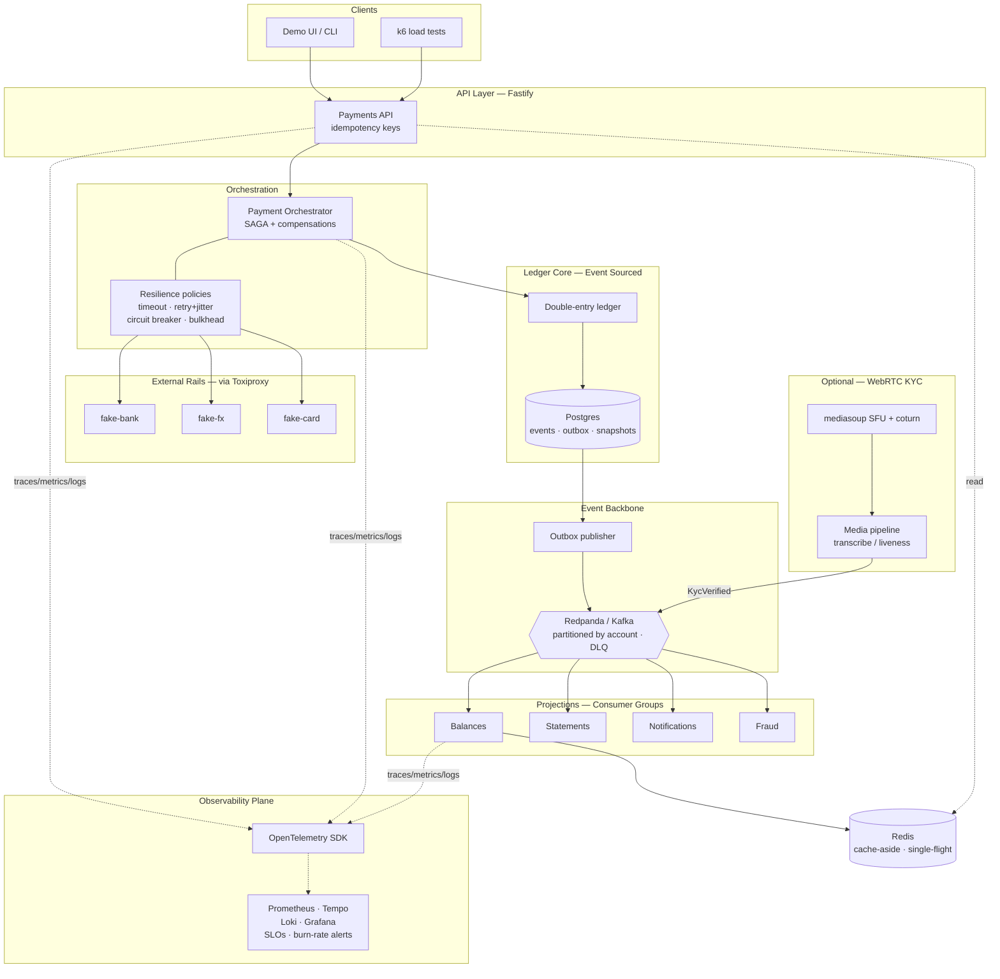

# LedgerRail

**A multi-currency wallet & payments orchestrator — an event-sourced double-entry ledger that moves real money across third-party rails, built to be correct under crashes, retries, and partial failure.**

<!-- Swap these for real once CI is wired up -->


> Money can't be double-spent, lost, or created. That single constraint forces every hard distributed-systems pattern to be *load-bearing* rather than decorative: idempotency, the transactional outbox, orchestrated sagas with compensations, and an event-sourced source of truth. This repo is a working demonstration of those patterns under deliberate failure.

---

## Architecture



**Read path is CQRS:** the append-only ledger journal in Postgres is the single source of truth; balances, statements, notifications and fraud signals are all **projections** rebuilt by replaying events. Nothing reads the write model directly.

---

## What this demonstrates

| Area | Where it lives in the code | The interview-legible decision |
|---|---|---|
| **Distributed transactions** | Cross-currency payment = orchestrated **SAGA** with compensations across ledger + external rails | You can't 2PC a third-party bank — SAGA is the only correct option; compensations over rollback |
| **Idempotency & outbox/inbox** | Idempotency key on every write; events published via a **transactional outbox**; consumers dedup via an **inbox** | Solves the dual-write problem — no double-pay on client retry, no lost event on crash-between-commit-and-publish |
| **Event Sourcing & CQRS** | Append-only `events` journal is source of truth; balances are projections; **snapshots** cap replay; events are **versioned** | Auditable, replayable history — a ledger that stores only current balances can't answer "why?" |
| **Kafka / event-driven** | Domain events through **Redpanda**, partitioned by account for per-wallet ordering; consumer groups; **DLQ**; lag monitoring | At-least-once + idempotent consumers over Kafka EOS — a deliberate, defensible tradeoff |
| **Resilience** | Every rail call: timeout → retry+jitter → circuit breaker → **bulkhead** → load shedding → cached-rate fallback | Bulkheads stop one slow dependency (FX at p99=10s) from starving unrelated payments |
| **Caching** | Redis cache-aside for hot balances & FX rates; **single-flight** + jittered TTL for stampede control | Prevents the thundering herd on a hot merchant at settlement close |
| **Observability** | OpenTelemetry traces one payment end-to-end; RED + business SLIs; **multi-window burn-rate** SLO alerts | Burn-rate alerting catches slow error-budget leaks a static p99 threshold sleeps through |
| **WebRTC** *(optional)* | Server-terminated **mediasoup** SFU pipes KYC-call audio into a pipeline; emits `KycVerified` to release a held payment | Honest scope note: real but domain-adjacent — cut cleanly if time-boxed |

---

## Tech stack

| Layer | Choice |
|---|---|
| API & services | Node.js · TypeScript · Fastify |
| Source of truth | Postgres (events · outbox · snapshots; money as integer minor units) |
| Event backbone | Redpanda (Kafka API; Raft internally → real quorum drills) |
| Cache | Redis |
| Resilience | cockatiel (retry · circuit breaker · bulkhead · timeout · fallback) |
| Observability | OpenTelemetry → `grafana/otel-lgtm` (Prometheus · Tempo · Loki · Grafana) |
| Fault injection | Toxiproxy (latency · partitions · drops) |
| Load testing | k6 |
| WebRTC *(optional)* | mediasoup (SFU) · coturn (STUN/TURN) |
| Local infra | Docker Compose |

---

## Quickstart

```bash
git clone https://github.com/<you>/ledger-rail && cd ledger-rail
cp .env.example .env
docker compose up -d          # postgres, redpanda, redis, mock rails, otel-lgtm, toxiproxy
pnpm install
pnpm migrate && pnpm seed     # accounts + opening balances

# move money
pnpm demo:payment             # cross-currency payment, end to end
open http://localhost:3000    # demo UI
open http://localhost:3001    # Grafana — dashboards, traces, SLOs
```

Then run a failure drill:

```bash
pnpm drill:double-pay         # rail acks late → naive retry double-pays; watch the reconciler catch it
pnpm drill:bulkhead           # slow the FX rail; watch settlement stay healthy
pnpm drill:stampede           # expire a hot key under load; watch single-flight collapse the herd
```

---

## Roadmap

Each stage is independently runnable and demoable.

- [ ] **1 · Ledger core** — event-sourced double-entry ledger, idempotency keys, snapshots *(weekend)*
- [ ] **2 · Outbox → Kafka → projections** — transactional outbox, CQRS read models, inbox dedup, DLQ, schema evolution *(weekend)*
- [ ] **3 · Payment saga** — orchestrated saga across external rails, compensations, reconciliation *(1–1.5 wk)*
- [ ] **4 · Resilience** — timeouts, retry+jitter, circuit breakers, bulkheads, load shedding, degradation *(1 wk)*
- [ ] **5 · Observability** — OTel tracing, RED + business SLIs, SLOs, multi-window burn-rate alerts *(1 wk)*
- [ ] **6 · Caching** — cache-aside, single-flight, jittered TTL, warming, eviction *(0.5–1 wk)*
- [ ] **7 · WebRTC KYC** *(optional)* — server-terminated SFU → media pipeline → `KycVerified` *(1–1.5 wk)*

---

## Failure drills

Correctness is proven by breaking things on purpose. Each drill has a script, a dashboard to watch, and a documented fix.

| Drill | Break | Observe | Fix |
|---|---|---|---|
| **Double-pay** | Bank rail commits, then fails before ack | Naive retry pays twice | End-to-end idempotency key + pre-compensation reconciliation |
| **Lost event** | Kill publisher between DB commit and Kafka publish | Event still delivered | Transactional outbox guarantees eventual publish; inbox dedups |
| **Lost quorum** | Kill 2 of 3 Redpanda brokers | Writes stall | Raft needs majority — demonstrates the availability/consistency line |
| **Cascading failure** | FX rail p99 → 10s under load | Without bulkheads, settlement fails too | Isolated worker pools per dependency |
| **Cache stampede** | Expire hot merchant key at 500 rps | Postgres CPU spikes (herd) | Single-flight + jittered TTL |
| **Silent SLO leak** | Inject a low-rate error | Fast-burn window pages; slow-burn catches the leak | Multi-window multi-burn-rate alert |

---

## Design decisions & tradeoffs

The details a staff interview actually probes — documented in [`docs/decisions/`](docs/decisions) as ADRs.
[`docs/flows/`](docs/flows) draws the same story: one document per checkpoint, each showing the
architecture before it, the mechanism it introduced, and the architecture after.

- **SAGA over 2PC** — a third-party bank exposes no prepare/commit phase, so distributed transactions are impossible; we accept eventual-consistency windows and compensations in exchange for being able to transact at all.
- **At-least-once + idempotent consumers over Kafka EOS** — simpler operational model, no transactional-producer coupling; correctness moves to the inbox instead of the broker.
- **Transactional outbox over dual-write** — the only crash-safe way to atomically commit state and publish an event from a single database.
- **Integer minor units over decimals/floats** — money is never floating point; currency travels with every amount.
- **Snapshots over full replay** — replay from event zero is O(history); periodic balance snapshots make projection rebuild bounded.

---

## Repository layout

```
ledger-rail/
├── services/
│   ├── api/            # Fastify edge — idempotency, auth
│   ├── orchestrator/   # payment saga + resilience policies
│   ├── ledger/         # event-sourced double-entry core
│   ├── projections/    # Kafka consumers → read models
│   └── rails/          # fake-bank, fake-fx, fake-card (chaos flags)
├── packages/
│   ├── events/         # versioned event schemas + upcasters
│   └── money/          # minor-unit money type
├── infra/
│   ├── docker-compose.yml
│   ├── grafana/        # dashboards, SLOs, alert rules
│   └── toxiproxy/      # fault-injection configs
├── drills/             # failure-drill scripts
├── load/               # k6 scenarios
└── docs/
    ├── architecture.md
    ├── decisions/      # ADRs — why
    └── flows/          # per-checkpoint before / change / after diagrams
```

---

## License

MIT
