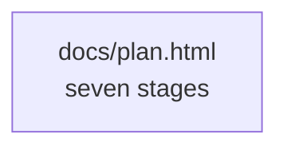
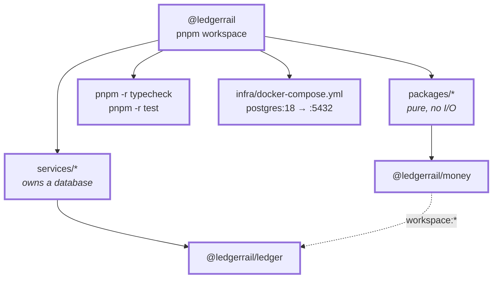
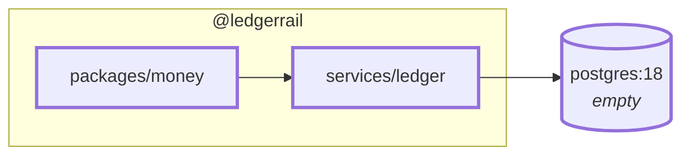

# 1.0 — Repo, tooling & local infra

**Stage:** 1 · **ADR:** — · **Commit:** `c4915dd`

> There is a place to put a ledger, a database to put it in, and two gates that fail the build
> before a test does.

## Before

Nothing. The only artefact is [`docs/plan.html`](../plan.html) — seven stages, and the claim
that each one ends in something runnable.

The question this checkpoint answers is the least interesting and most load-bearing one:
*where does code go, and what has to be true before it is allowed to run?*

## The change

A pnpm workspace with two kinds of member, and the distinction is not cosmetic — it is the
first architectural boundary in the project.

A package may not import a service. That arrow only ever points one way, and every later
checkpoint that puts a decision in `money` rather than in `ledger` is spending this rule.

## After

## What moved

| Before | After |
| --- | --- |
| a plan | a workspace with a pure half and an impure half |
| — | Postgres 18 in Compose, on 5432 |
| — | `typecheck` and `test` run recursively across both members |

## What this did not solve

The database is empty and nothing knows what money is. 1.1 does the second one first,
deliberately: the type every posting sits on should exist before the first posting does.
