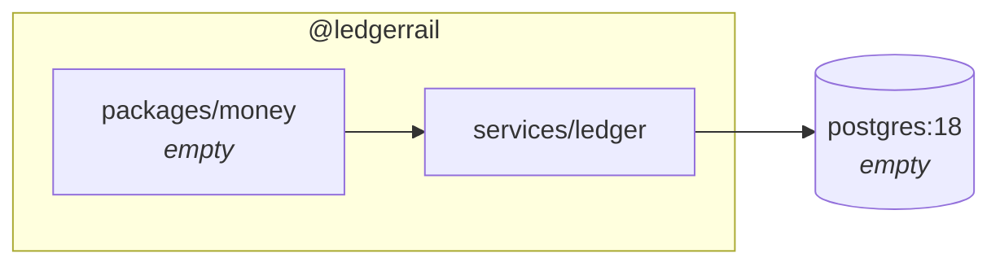
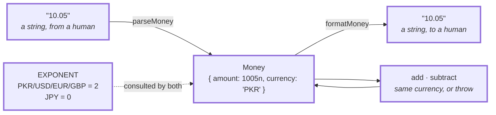
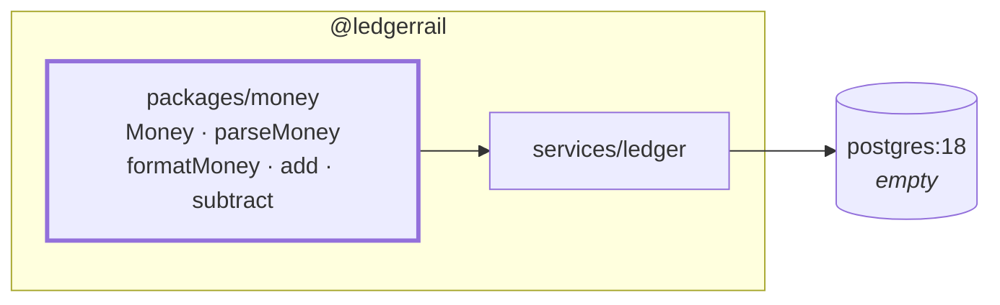

# 1.1 — The Money type

**Stage:** 1 · **ADR:** — · **Commit:** `c4915dd`

> Money is a `bigint` of minor units plus a currency, and there is no code path in the project
> on which a float can touch an amount.

## Before

Nothing in the repo can hold `10.05` without lying about it.

## The change

The whole design is one decision — **the integer is the value, the decimal is a rendering** —
and everything else follows from which direction the arrows point.

Two things the diagram is making a point of:

- **`number` appears nowhere on it.** There is no `toNumber`, so there is no accident to make.
- **The exponent is per currency, not a constant 2.** JPY has no minor unit. This costs nothing
  in 1.1 and is the reason [3.3](3.3-orchestrator.md)'s `convert` lands in the right place —
  a rate is quoted between *major* units, so USD→JPY needs a shift the integers do not imply.

The round trip is proven by a property test rather than by examples: for any amount,
`parseMoney(formatMoney(m)) === m`.

## After

## What moved

| Before | After |
| --- | --- |
| no representation of an amount | `bigint` minor units + `Currency` |
| — | decimal strings only at the edges, both directions |
| — | mixed-currency arithmetic throws rather than coerces |

## What this did not solve

Nothing is stored. 1.2 gives the database a shape — and the amounts it stores are the integers
defined here, which is why this came first.
