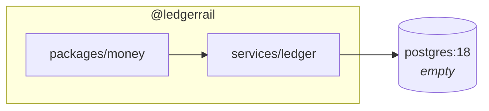
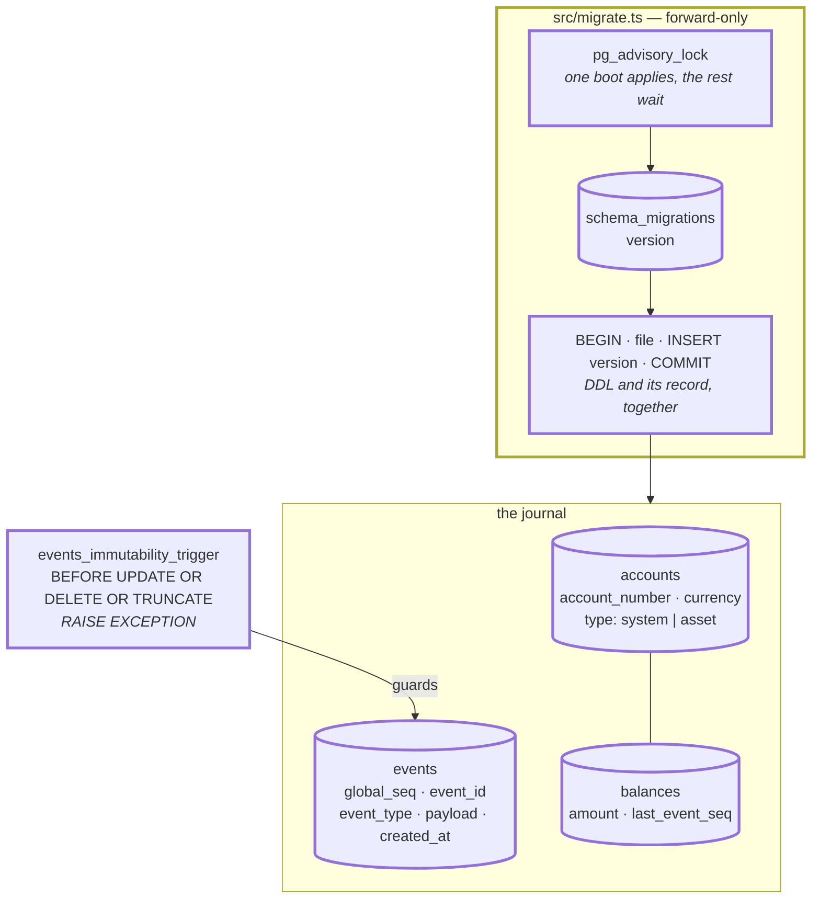
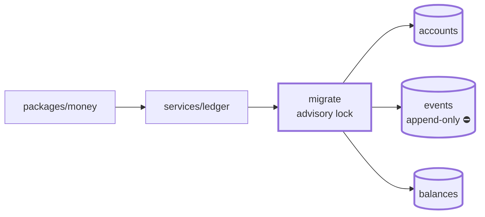

# 1.2 — Event-store schema

**Stage:** 1 · **ADR:** — · **Commit:** `7ed5392`

> The journal exists, and the database itself refuses to let it be rewritten.

## Before

An empty database and no way to change it twice the same way. Both problems are this
checkpoint's.

## The change

Two things, and they are the same thing seen from different ends: **schema changes are ordered
and applied once**, and **facts are ordered and written once**.

Three choices worth naming on the picture:

- **The trigger, not a convention.** "We only ever `INSERT`" is a promise the codebase makes and
  a migration, a console session or a future maintainer can break. `RAISE EXCEPTION` is a
  promise the database keeps.
- **`global_seq` is `GENERATED ALWAYS AS IDENTITY`, and it is the primary key.** Ordering is the
  journal's most important property, so it is the thing the row is identified by. `event_id`
  is a separate `UUID UNIQUE` — an identity to hand outward, which is what
  [2.1](2.1-outbox.md) and [2.4](2.4-inbox.md) will need.
- **`balances.last_event_seq`.** From the first day the balance row records *how far it has
  read*, not just what it holds. In 1.2 that is bookkeeping. From [2.3](2.3-projection-behind-the-log.md)
  it is the only honest answer to "is this number stale?", and in
  [2.7](2.7-stage-2-drills.md) getting the watermark wrong is the bug.

## After

## What moved

| Before | After |
| --- | --- |
| empty database | `accounts`, `events`, `balances` |
| — | append-only enforced by trigger, not by discipline |
| ad-hoc schema | forward-only migrations, serialised by advisory lock, DDL in a transaction |

## What this did not solve

Nothing writes to it. There are three tables and no rule that says a write to one has to be
balanced — 1.3 is where the ledger becomes a ledger.
