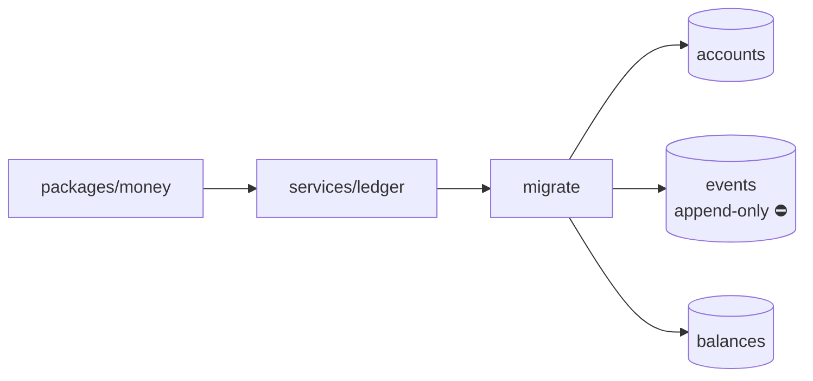
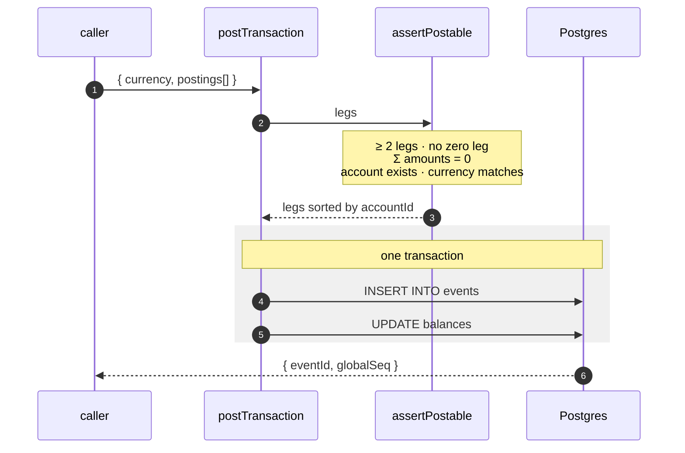
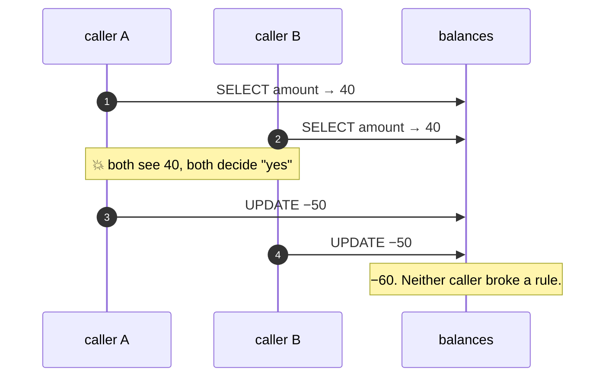
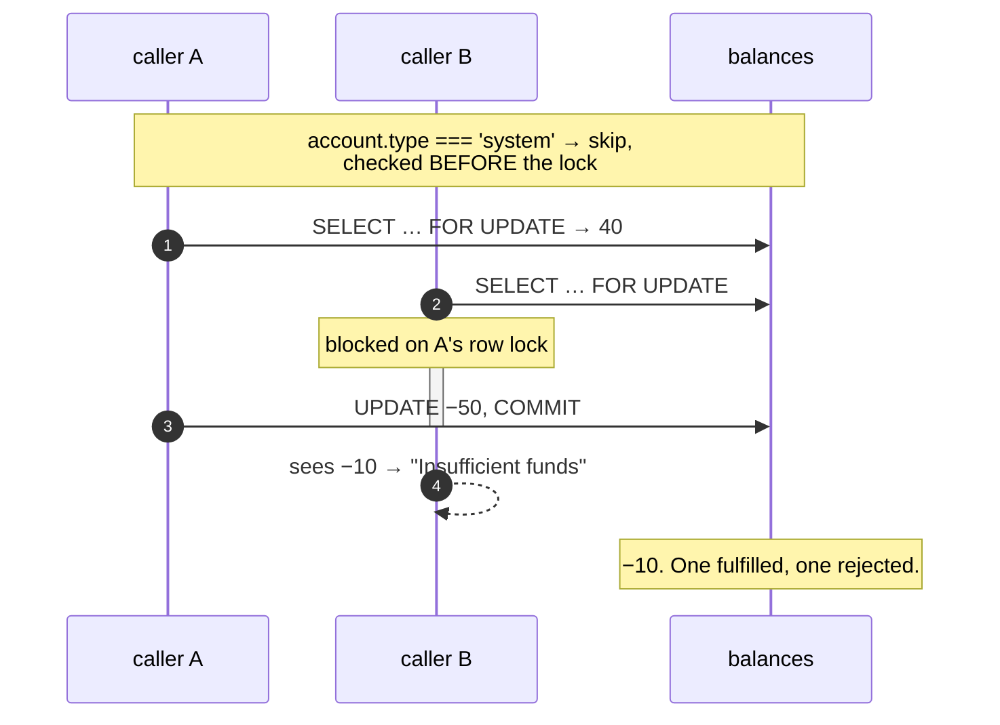
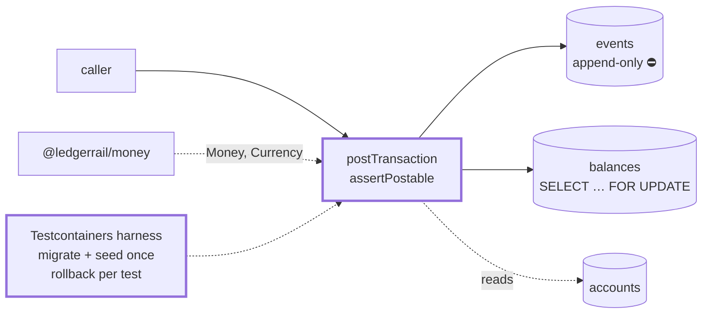

# 1.3 — PostTransaction + the double-entry invariant

**Stage:** 1 · **ADR:** [0002](../decisions/0002-overdraft-locking.md) ·
**Commits:** `8e5a1a1` (layer 1) `f0a0d34` (layer 2) `ba83c2e` (layer 2, fixed)

> Money moves only through one function, only in balanced pairs, and an account cannot be
> overdrawn — including by two callers who ask at the same moment.

## Before

Three tables, no writer, no invariant. Anything could insert one leg of a transfer and stop.

## The change — layer 1: one command, one transaction

**Σ = 0 is checked before anything is read**, so a malformed transaction never reaches the
database. And the legs come back **sorted by `accountId`** — every command takes its row locks
in the same order, so two transactions over the same pair of accounts queue instead of
deadlocking. That sort is doing real work from the next layer onward.

The event and the balance write are one transaction. That is the property
[1.7](1.7-demo-and-drill.md)'s crash drill kills a process to prove, and the property
[2.1](2.1-outbox.md) has to extend to a third write.

## The change — layer 2: the overdraft race, and the fix

The first version of the guard read the balance, decided, then wrote. Under two connections
that is a lost update, and the reproduction test drove a balance to **−60**:

The fix is to make the read the lock:

The exemption ahead of the lock is the part worth remembering. System accounts have no floor,
so locking one buys nothing — and it would make **every funding transaction in the system
serialise on a single row**. Same reasoning, later, for why a hold's reserve is a system
account ([3.1](3.1-holds.md)) and why the reproduction test was kept and inverted into a
regression guard rather than deleted once it passed. See [ADR 0002](../decisions/0002-overdraft-locking.md).

## After

## What moved

| Before | After |
| --- | --- |
| no writer | one command, and money moves through nothing else |
| — | Σ = 0, currency and account checks, ≥ 2 legs |
| read-then-write balance | `SELECT … FOR UPDATE` on each debited row |
| — | system accounts exempt *before* the lock, not after |
| — | hermetic integration harness: migrate + seed in `globalSetup`, rollback per test |

## What this did not solve

A caller who retries because the response was lost posts the transaction twice. The command
has no memory of having been asked before — 1.4.
