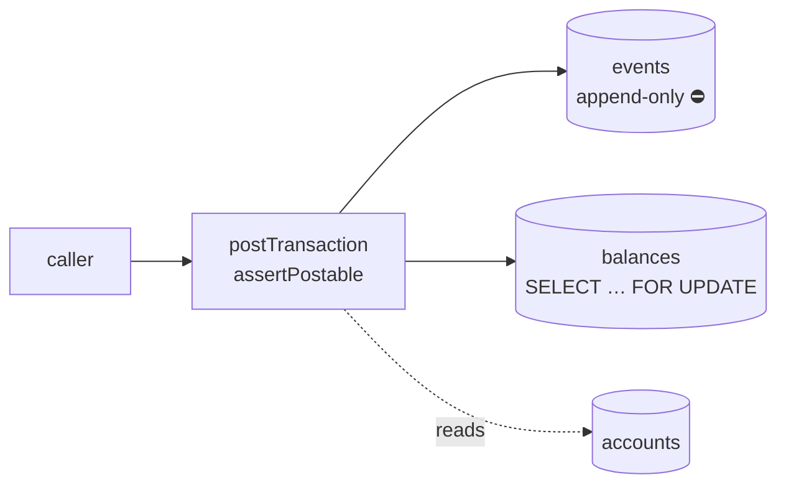
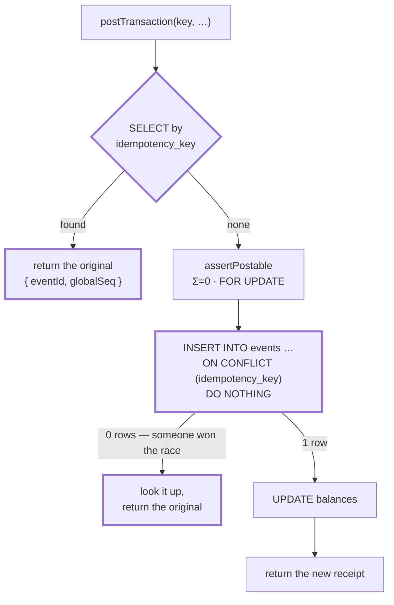
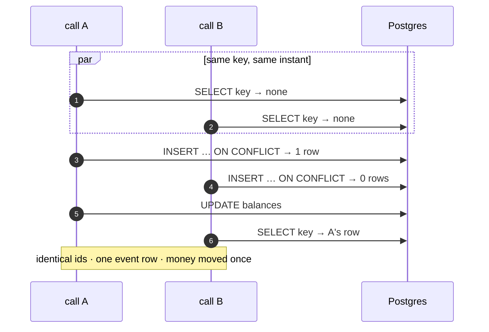
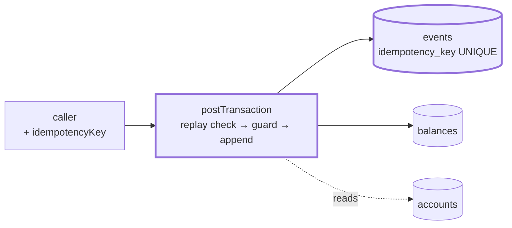

# 1.4 — Idempotency keys

**Stage:** 1 · **ADR:** — · **Commit:** `a8311d5`

> A caller may send the same request as many times as it likes. The money moves once, and every
> call gets the same receipt back.

## Before

A network timeout is not a failure — it is a *lost answer*. The caller cannot tell the two
apart, so it retries, and the ledger posts twice.

## The change

Two checks, and they are not redundant. They answer different questions.

- The **`SELECT` up front** is for *retry later*: the first call has long since committed.
- The **`ON CONFLICT`** is for *retry now*: two callers raced, both found nothing, both passed
  the guard, and exactly one insert survives. The loser must return the winner's receipt and
  **must not touch balances** — the row it would have added is already accounted for.

The order matters, and it took until [3.1](3.1-holds.md) to find out how much: the guard used
to run first, so replaying a key whose original had already spent the funds failed with
*Insufficient funds* instead of returning a receipt. Invisible to the concurrency test, because
both of its callers race *before* balances move.

The concurrency test drives it for real — two simultaneous calls, one key:

## After

## What moved

| Before | After |
| --- | --- |
| a retry posts twice | a retry returns the original receipt |
| — | `idempotency_key` is `UNIQUE` on `events` — the database owns once-only, not the code |
| — | balance updates skipped on every replay path |

## What this did not solve

The balance is computed in one place — inside the command — and there is no way to recompute it
from the journal. If `balances` is ever wrong, nothing can rebuild it. 1.5.
