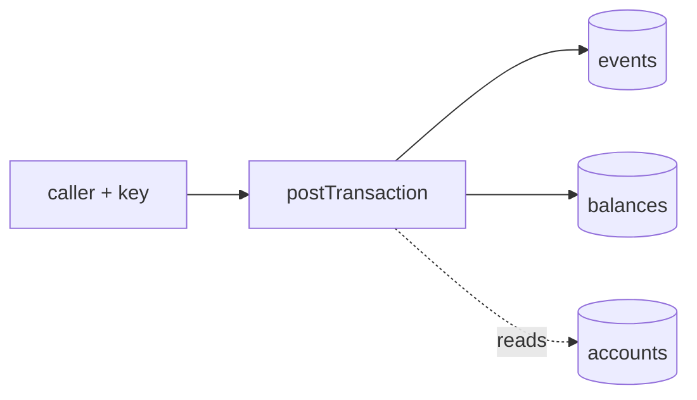
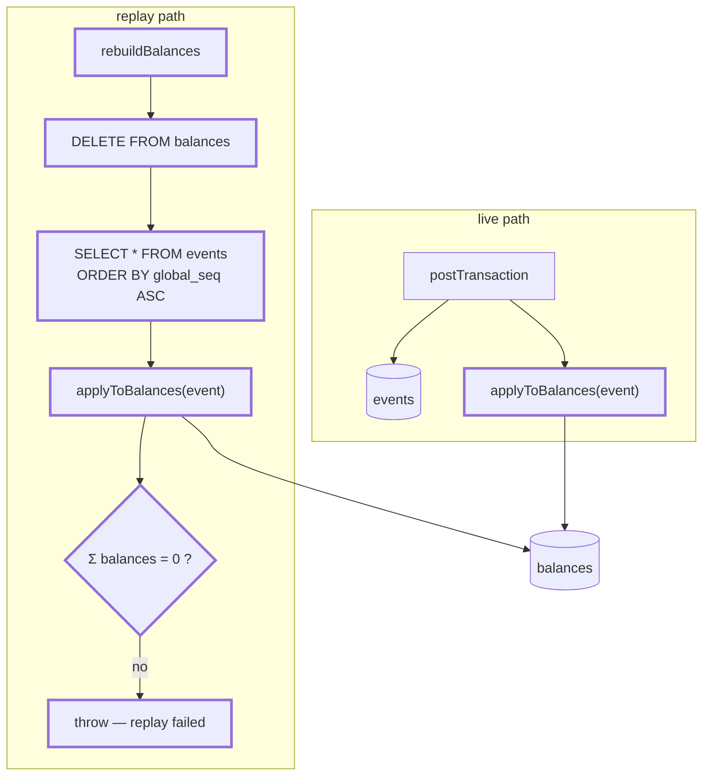
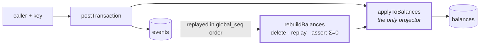

# 1.5 — Balance projection

**Stage:** 1 · **ADR:** — · **Commit:** `b3f39cb`

> The balance stops being something the command computes and becomes something the journal
> implies — and there is exactly one function that does the implying.

## Before

`UPDATE balances` is written inline in the command. The journal is the record of truth in
principle and nothing can actually derive anything from it.

## The change

One projector, two callers.

Three decisions the picture is making:

- **`applyToBalances` is extracted, not duplicated.** Two implementations of "what an event does
  to a balance" drift, and the one that drifts is the replay — because nothing in normal
  operation runs it. By [2.6](2.6-schema-evolution.md) this pays off directly: the upcaster
  goes on the *first line* of this function, so the rebuild cannot forget what the consumer
  remembers.
- **The command projects from the persisted row**, not from the object it just built. Live and
  rebuild therefore consume identical bytes, including whatever `JSONB` did to them on the way
  in.
- **Σ = 0 asserted after the replay.** Every event is balanced, so every *sum* of events is
  balanced. A rebuild that ends anywhere else dropped or double-applied something.

`Σ = 0` is a strong check with one specific blind spot, and 1.6 walks into it.

## After

## What moved

| Before | After |
| --- | --- |
| balance logic inline in the command | `applyToBalances`, shared by both callers |
| journal is authoritative in principle | `rebuildBalances` makes it authoritative in fact |
| — | Σ = 0 asserted at the end of every replay |
| projects from the in-memory object | projects from the persisted event row |

## What this did not solve

A rebuild reads every event ever written, from the beginning, forever. 1.6 gives it a place to
start.
