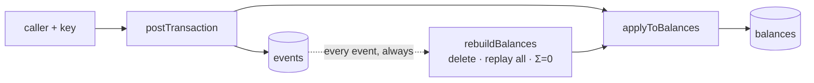
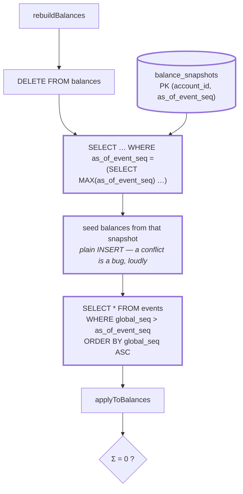
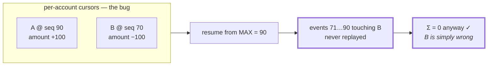
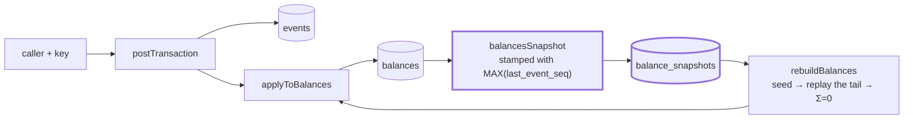

# 1.6 — Snapshots + replay

**Stage:** 1 · **ADR:** — · **Commit:** `add4858`

> A rebuild no longer starts at the beginning of time. It starts at a snapshot, and the snapshot
> is one moment for every account, not one moment per account.

## Before

Correct and unbounded. The cost of a rebuild grows with the age of the ledger.

## The change

**One cursor per snapshot, shared by every account in it.** That is the whole design, and the
bug it guards against is worth drawing, because Σ = 0 cannot see it:

Σ = 0 holds over whatever survives — it is an invariant of the *set* of applied events, not
evidence that the right set was applied. The regression test writes two pairs at differing
cursors precisely to catch the account this drops.

And the cursor is read from **`MAX(last_event_seq)` in `balances`** — the projection's own
watermark, not the journal's head. In 1.6 those are the same number, because the command writes
the balance inside its own transaction. From [2.3](2.3-projection-behind-the-log.md) they are
not, and that gap is [ADR 0009](../decisions/0009-snapshot-cursor.md).

## After

## What moved

| Before | After |
| --- | --- |
| replay from event 1, always | seed from the latest snapshot, replay only beyond it |
| — | `balance_snapshots (account_id, as_of_event_seq)` |
| — | one global cursor per snapshot — not one per account |
| — | seeding uses a plain `INSERT`: a conflict means the delete did not happen |

## What this did not solve

Every piece has a test. Nothing has run the pieces together, and no test has ever pulled the
power out mid-write. 1.7.
