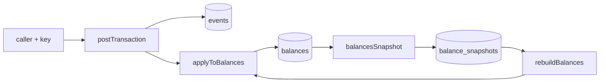
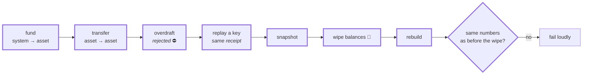
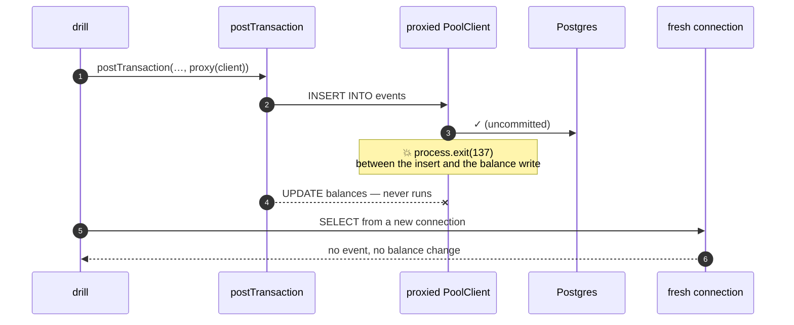
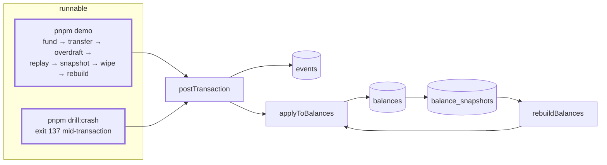

# 1.7 — Demo script + Stage 1 failure drill

**Stage:** 1 · **ADR:** — · **Commit:** `55d1f81`

> Stage 1 can be run as one story, and the atomicity it claims is proven by killing the process
> rather than by asserting it.

## Before

Every part is tested in isolation. Nobody has watched them work as a system, and "the event and
the balance commit together" is still an assertion about code rather than an observation about
a corpse.

## The change — `pnpm demo`, the whole stage as one narrative

The wipe is the point. A demo that only adds is a demo that cannot detect a lie — the numbers
are captured before `DELETE`, and the run fails if the rebuild disagrees.

## The change — `pnpm drill:crash`, killing the gap

The kill goes in **a proxy around the injected client**, not in the command. Nothing in
`postTransaction` knows a drill exists, so what the drill proves is a property of the shipped
code path rather than of a test-only branch. That injection point is reused every time
afterwards — [2.7](2.7-stage-2-drills.md)'s `killAfterSend` is the same trick around a producer.

## After

**End of Stage 1.** One process, one database, one transaction. Every guarantee in the picture
above is bought with `BEGIN … COMMIT`, and Stage 2 is what happens when that stops being
available.

## What moved

| Before | After |
| --- | --- |
| parts tested in isolation | one narrative that exercises all of them and checks itself |
| atomicity asserted | atomicity observed, from a fresh connection, after a `SIGKILL` |
| — | the injected-client seam becomes the standard place to inject a failure |

## What this did not solve

Nothing outside this process can learn that money moved. 2.0 starts the plumbing that lets it.
