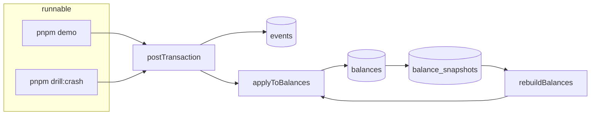
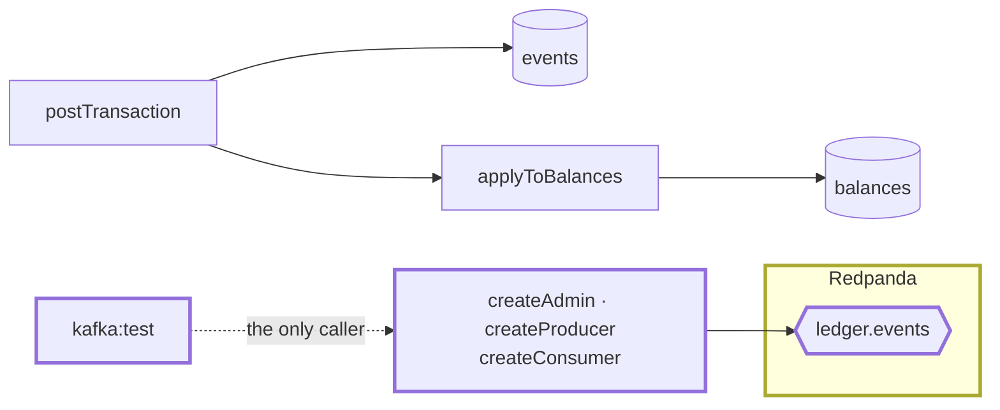

# 2.0 — Kafka plumbing

**Stage:** 2 · **ADR:** — · **Commit:** `40507b9`

> There is a broker, and there are three factories that hand back a handle instead of a
> singleton. Nothing in the ledger uses them yet.

## Before

One process, one database. Everything Stage 1 guarantees, it guarantees with a transaction.

## The change

```mermaid
flowchart TD
    subgraph compose["infra/docker-compose.yml"]
        rp["Redpanda<br/>advertised listeners: 19092"]
        console["Redpanda Console<br/>:9000"]
    end

    subgraph client["src/kafka"]
        memo["getClient()<br/><i>lazily memoized</i>"]
        admin["createAdmin() → AdminHandle"]
        prod["createProducer() → ProducerHandle"]
        cons["createConsumer() → ConsumerHandle"]
        memo --> admin & prod & cons
    end

    client --> rp
    smoke["kafka:test<br/>produce → consume a keyed message"] --> client

    class rp,console,memo,admin,prod,cons,smoke new
    classDef new stroke-width:3px
    classDef gone stroke-dasharray:5 4
```

Two details that are the whole checkpoint:

- **Advertised listeners, correctly.** A broker tells a client where to reconnect. Get it wrong
  inside Docker and the first connection succeeds, the second is told to dial a hostname that
  does not exist outside the network, and the failure looks like anything but configuration.
- **Handles, not module singletons.** `createProducer()` returns something a caller owns and
  disconnects. A module-level producer cannot be substituted, and [2.2](2.2-relay.md)'s relay
  test runs against a fake producer with no broker at all — which is only possible because the
  producer arrives as an argument.

The smoke script waits deterministically for the message it produced, rather than sleeping.
A timing-based test against a broker is a test that will lie to you eventually.

## After

Note the missing arrow: **`postTransaction` does not touch Kafka.** It is not going to, either —
2.1 makes it write a row, not send a message.

## What moved

| Before | After |
| --- | --- |
| — | Redpanda + Console in Compose, listeners advertised correctly |
| — | one lazily-memoized client; admin/producer/consumer factories returning handles |
| — | a smoke script that produces and consumes with a deterministic wait |

## What this did not solve

The ledger and the broker are two systems that can each succeed while the other fails. Writing
to both from one command is the dual-write problem, and 2.1 refuses to have it.
