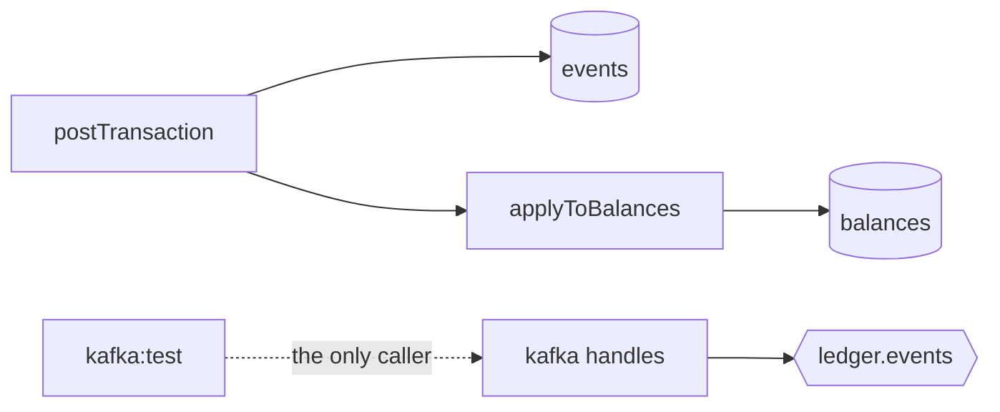
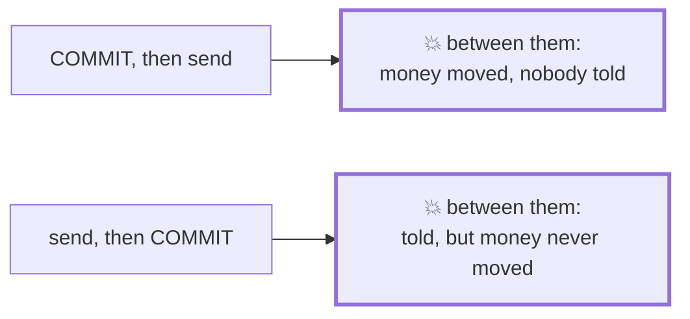
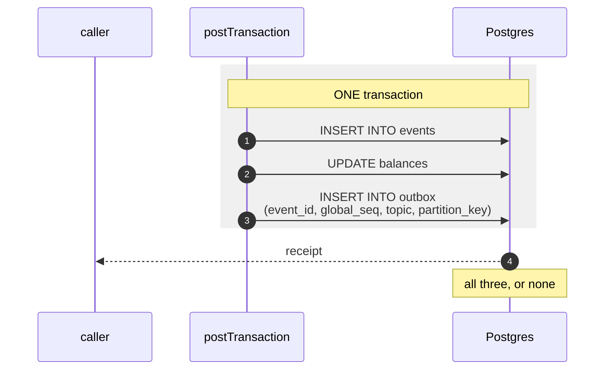
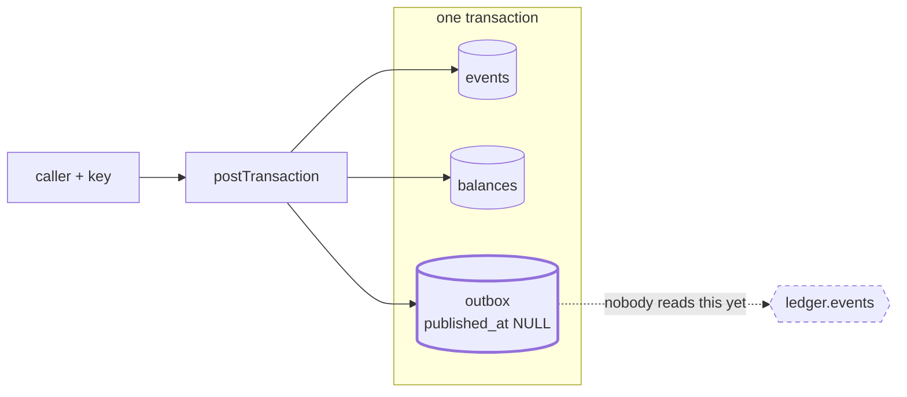

# 2.1 — Transactional outbox

**Stage:** 2 · **ADR:** [0003](../decisions/0003-outbox-and-event-partitioning.md) · **Commit:** `d4bd17d`

> The command never talks to Kafka. It writes the *intent* to publish into the same transaction
> as the event, so an event row exists if and only if its outbox row does.

## Before

The obvious next move is to `send()` at the end of the command. That is the dual write, and it
has no safe ordering:

## The change

Make the second write go to a table in the same database, so there is only one commit.

The `outbox` row carries more than a pointer, and each extra column is deliberate:

| column | why it is stored rather than derived |
| --- | --- |
| `global_seq` | copied from `events` so the publisher can order its work without a join |
| `topic` | the domain thinking happens once, at write time — the publisher reads a row and sends it |
| `partition_key` | self-describing, `transaction:<event_id>`, so ordering is decided by the writer |
| `published_at` | nullable: answers *is it sent?* **and** *how long has it been stuck?* A boolean throws the second question away |

The index is partial on purpose. The table grows forever; the *work queue* inside it is
whatever has not been published yet, and that is the only part anyone scans.

**The outbox insert is skipped on an idempotent replay**, which is what makes the biconditional
hold: one event row, one outbox row, never two of either. The crash drill from
[1.7](1.7-demo-and-drill.md) is extended to prove all three writes roll back together.

## After

## What moved

| Before | After |
| --- | --- |
| two systems, two commits, no safe order | one commit; the intent to publish is a row |
| — | `outbox` with `global_seq`, `topic`, `partition_key`, nullable `published_at` |
| — | partial index over unpublished rows |
| — | crash drill proves all three writes roll back together |

## What this did not solve

The rows sit there. Nothing drains them — 2.2.
