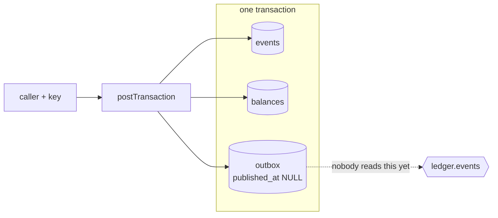
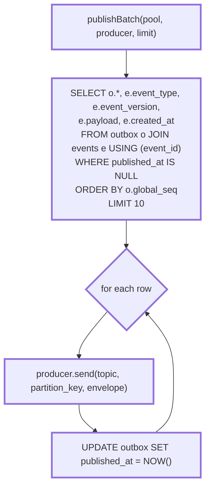
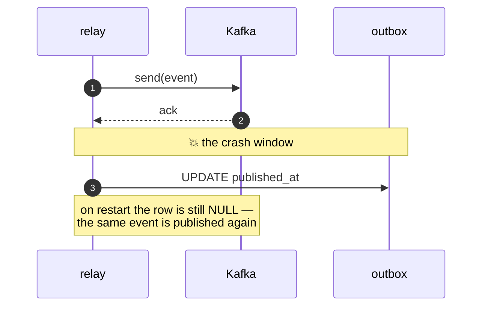
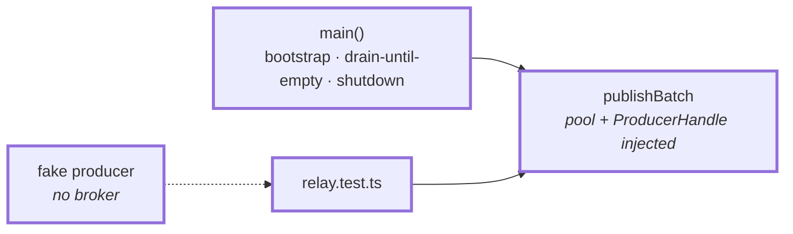
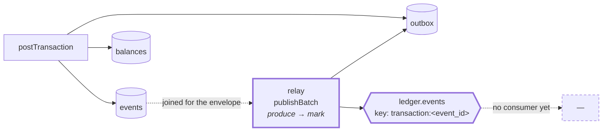

# 2.2 — The relay

**Stage:** 2 · **ADR:** [0003](../decisions/0003-outbox-and-event-partitioning.md) · **Commit:** `3acd864`

> Something drains the outbox into Kafka. It publishes before it marks, which makes delivery
> at-least-once — chosen, not conceded.

## Before

Rows accumulate and go nowhere.

## The change

**The envelope is joined, not stored.** The outbox holds routing; `events` holds the fact. The
publisher assembles `{ event_id, event_type, event_version, global_seq, payload, created_at }`
at send time, so a schema change does not have to rewrite queued rows —
[2.6](2.6-schema-evolution.md) depends on `event_version` riding along here.

### Produce-then-mark, and what it costs

The reverse order — mark, then send — closes this window and opens a worse one: a row marked
published that never was, which is silent and permanent. **At-least-once is recoverable;
at-most-once is not.** Duplicates therefore become the consumer's problem, deliberately, and
[2.4](2.4-inbox.md) is where that debt is paid. [`drill:relay`](../../services/ledger/scripts/drills/drill-relay.md)
kills the process in exactly this gap.

### Two mains, two responsibilities

`publishBatch` takes its pool and producer as arguments and knows nothing about bootstrap, so
the whole publishing rule is testable without a broker. `main()` owns the loop that drains
until a batch comes back empty.

## After

## What moved

| Before | After |
| --- | --- |
| outbox rows accumulate | a relay drains them in `global_seq` order |
| — | envelope joined from `events` at publish time |
| — | produce-then-mark, recorded as a deliberate at-least-once choice |
| — | `publishBatch` injectable, so the rule is tested against a fake producer |

## What this did not solve

`balances` is still written by the command, inside the transaction. There is a topic full of
events and nothing consuming them — and the moment something does, two writers own one table.
2.3.
