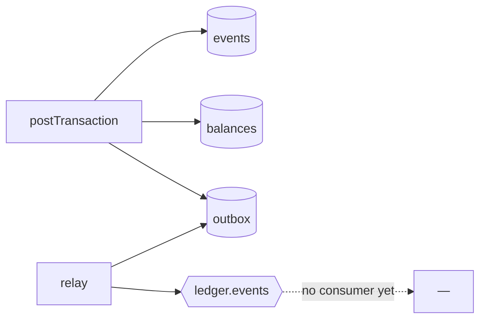
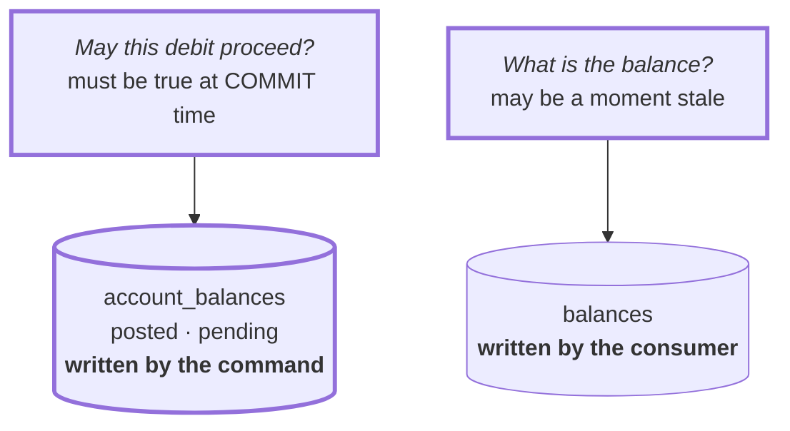
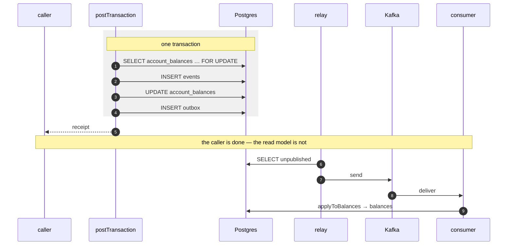
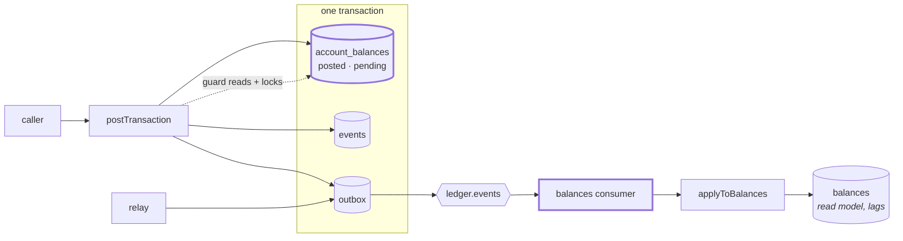

# 2.3 — Projection behind the log

**Stage:** 2 · **ADR:** [0004](../decisions/0004-write-side-balances.md) · **Commit:** `d2d04be`

> A consumer takes ownership of `balances`, which means the command can no longer read it to
> decide anything — so the overdraft invariant moves to a table the command owns.

## Before

## The change

Attaching a consumer to `balances` would give that table two writers. The fix is not locking —
it is **splitting the table by question**:

An invariant cannot be enforced against a lagging projection. If the guard reads a number that
is a second behind, the answer it gives is a second behind, and the overdraft it was meant to
prevent has already committed. So the guard reads and locks `account_balances` — same
transaction, same commit, [1.3](1.3-post-transaction.md)'s `FOR UPDATE` unchanged — and
`balances` becomes a read model that is allowed to be behind. [ADR 0004](../decisions/0004-write-side-balances.md).

The gap between the receipt and the last arrow is the whole of Stage 2. It is real, it is
visible ([`drill:lag`](../../services/ledger/scripts/drills/drill-lag.md)), and it is the price
of the read model being separable.

`account_balances` carries **`posted` and `pending` from the start**, and `pending` is unused
until [3.1](3.1-holds.md) — the seam for the day a held amount has to be subtracted from what
is available without having moved.

## After

## What moved

| Before | After |
| --- | --- |
| `balances` written by the command | `balances` written by the consumer, and only the consumer |
| overdraft guard reads `balances` | guard reads and locks `account_balances`, in its own transaction |
| — | `posted` / `pending` split, `pending` reserved for 3.1 |
| the read model is current | the read model lags, on purpose, and can be rebuilt |

## What this did not solve

Delivery is at-least-once ([2.2](2.2-relay.md)) and the consumer applies whatever it is handed.
A redelivered event moves money twice. 2.4.
