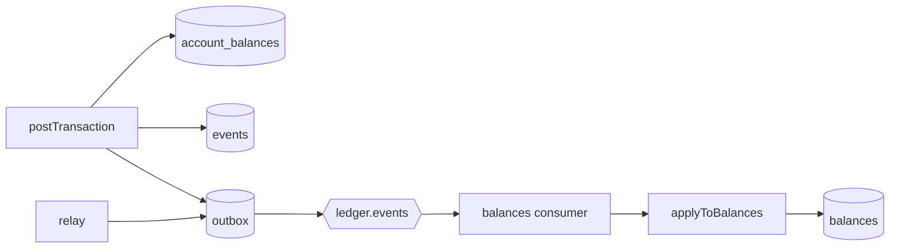
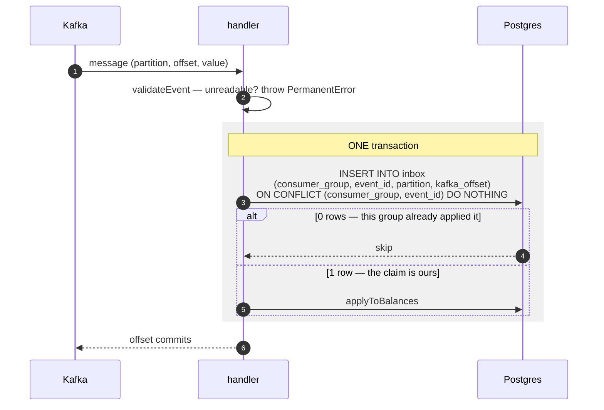
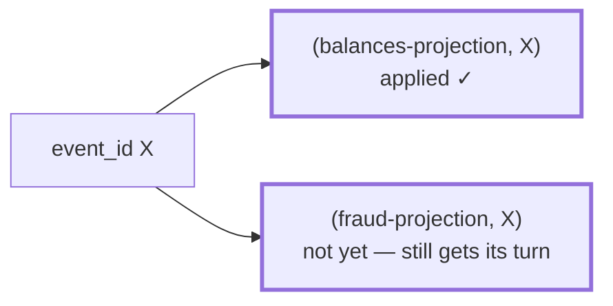
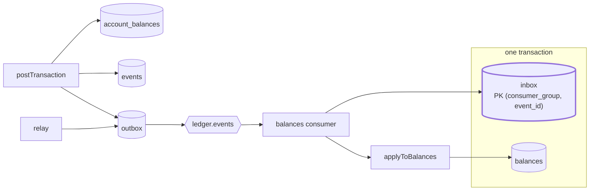

# 2.4 — Inbox & deduplication

**Stage:** 2 · **ADR:** [0005](../decisions/0005-consumer-inbox.md) · **Commit:** `f789614`

> The consumer claims each event in an inbox row and applies it in the *same* transaction, so
> at-least-once delivery produces an exactly-once effect.

## Before

[2.2](2.2-relay.md) chose at-least-once. This is where the bill arrives: the relay's crash
window republishes an event, and the consumer applies it a second time.

## The change

**The claim and the effect commit together.** That is the entire argument: there is no ordering
of two separate commits that survives a crash between them, so there is only one commit. Same
shape as [2.1](2.1-outbox.md)'s outbox, pointed the other way — the outbox makes *sending* part
of the write, the inbox makes *having received* part of the apply.

`ON CONFLICT … DO NOTHING` rather than catching a unique violation: a duplicate becomes zero
rows instead of an aborted transaction, exactly as in [1.4](1.4-idempotency.md).

### Why the key includes the group

Keying on `event_id` alone would let whichever consumer arrived first starve every other one.
The primary key is `(consumer_group, event_id)`, so the claim means *this group has applied
this event* — not *someone has*.

[ADR 0005](../decisions/0005-consumer-inbox.md) records the read-side foreign key on
`event_id`, and the condition that would reverse it: it is safe only while the journal lives in
the same database as the read model.

## After

## What moved

| Before | After |
| --- | --- |
| a redelivered event moves money twice | the claim and the effect are one commit |
| — | `inbox`, keyed `(consumer_group, event_id)` |
| — | per-group keying, so a second projection is never starved |
| — | unreadable messages throw `PermanentError` instead of committing the offset quietly |

## What this did not solve

That `PermanentError` has nowhere to go. It is rethrown, the offset does not advance, and one
bad message blocks its partition forever. 2.5.
