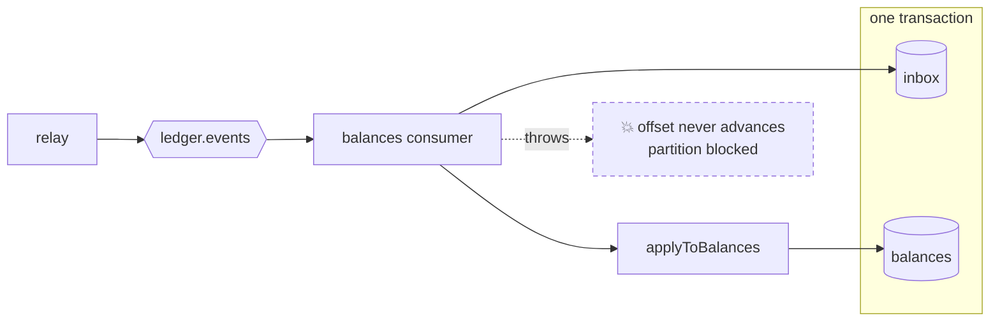
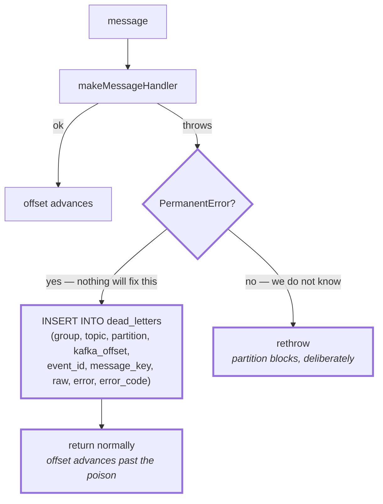
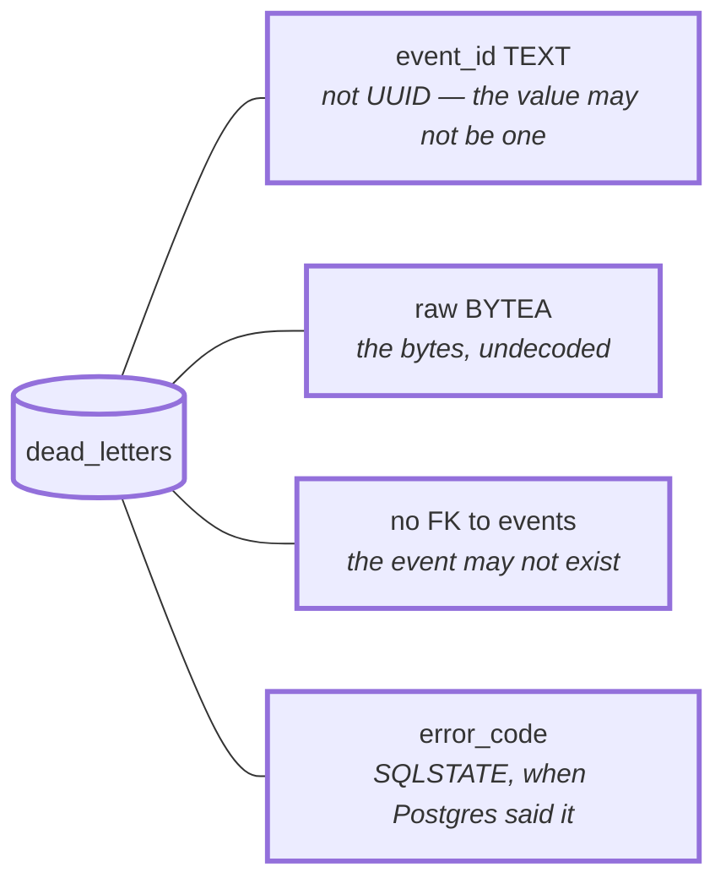
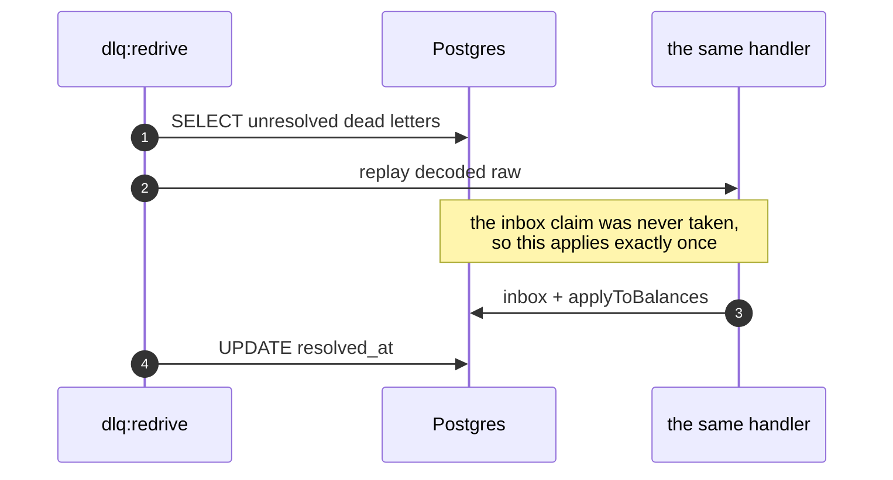
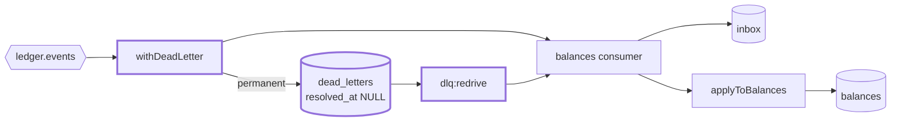

# 2.5 — Dead letter queue

**Stage:** 2 · **ADR:** [0006](../decisions/0006-dead-letter-queue.md) · **Commit:** `ac3ce92`

> A permanently bad message is recorded in a Postgres table and the handler returns normally, so
> the offset advances. A transient failure still blocks the partition — on purpose.

## Before

## The change

`withDeadLetter` wraps the handler and asks one question about the error:

**Why no retry budget in between:** during a database outage every message is transient, and a
budget would walk the whole topic into `dead_letters` — turning an outage into a data-migration
job. Blocking is the correct behaviour for *we do not know*: it stops, it is visible as lag,
and it resumes by itself.

### The table takes what it cannot validate

A dead-letter table with the schema of a valid event cannot store an invalid one. Every
constraint here would fire on exactly the rows this table exists to keep.

### Redrive replays through the same handler

**A dead letter never claims the inbox.** That is what makes redrive safe rather than a second
delivery path with its own rules — the once-only guarantee is still
[2.4](2.4-inbox.md)'s, unchanged.

[`drill:poison`](../../services/ledger/scripts/drills/drill-poison.md) proves it end to end: the
committed offset moves past the poison message, and the message behind it applies.
[ADR 0006](../decisions/0006-dead-letter-queue.md) records why a table beat a DLQ topic.

## After

## What moved

| Before | After |
| --- | --- |
| one bad message blocks a partition forever | permanent failures are recorded and stepped over |
| — | `dead_letters`, deliberately unconstrained, keyed by delivery position |
| — | transient failures still block, with no retry budget |
| — | `dlq:redrive` replays through the same handler, exactly once |

## What this did not solve

The events all look the same shape. The first time one does not — a new field, a new version —
the consumer will call it poison and dead-letter a message that is merely *newer*. 2.6.
