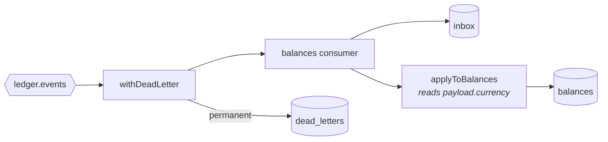
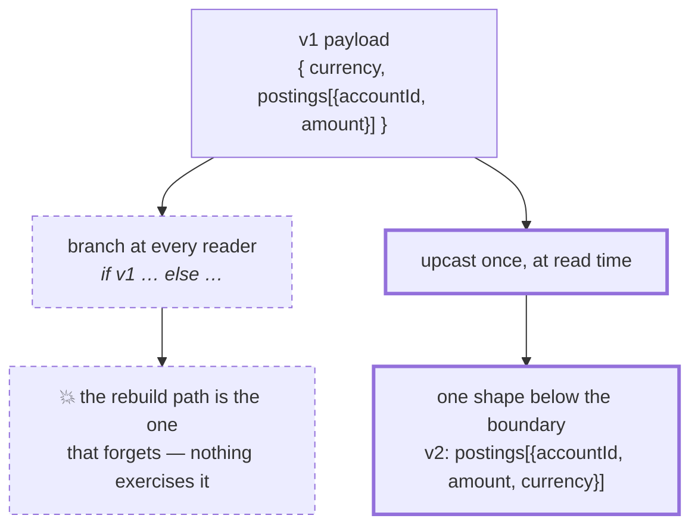
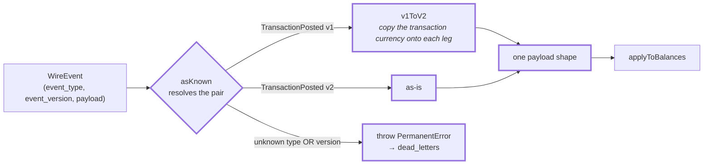
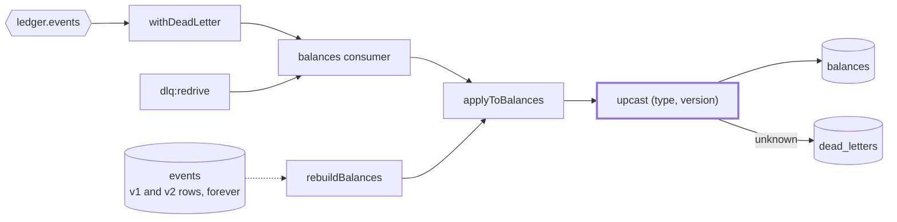

# 2.6 — Schema evolution

**Stage:** 2 · **ADR:** [0007](../decisions/0007-event-schema-evolution.md) · **Commit:** `0ccaf27`

> `TransactionPosted` v2 carries a currency per leg. v1 is reconciled by one pure function on
> the first line of the projector, so the projector has exactly one route to the money.

## Before

The journal is append-only and immutable ([1.2](1.2-event-store.md)), so a payload shape,
once written, is written forever. There is no migration to run.

## The change

Two candidate answers, and only one of them survives the rebuild:

Four things worth holding on to:

- **The upcast is the first line of `applyToBalances`,** not the first line of the consumer. The
  consumer, the rebuild and the redrive all enter through that function, so none of them can
  disagree about what an old event meant. This is what [1.5](1.5-balance-projection.md)'s single
  projector was for.
- **`v1ToV2` invents nothing.** The command has always rejected legs whose account currency
  differed from the transaction's, so copying it onto every leg reproduces exactly what the v1
  event meant. An upcaster that guesses is a lie applied to history that cannot be corrected.
- **Two mutually type-enforcing switches.** `asKnown` narrows `(type, version)` to a union;
  `upcast` exhausts that union. Adding a version without handling it fails to compile — the
  known-version list cannot drift from the code that uses it.
- **Unknown is permanent, not corrupt.** A version this build has never heard of is a message
  from the future. It dead-letters, and [2.5](2.5-dead-letters.md)'s redrive collects it after
  the upgrade — which is the first time the dead-letter table is used for something other than
  a bug.

The wire type also stops declaring `event_version: 1` — a value read off a message cannot be
promised by the type that reads it.

The cost, recorded in [ADR 0007](../decisions/0007-event-schema-evolution.md): **upcasters are
permanent.** `v1ToV2` is now as immutable as the events it reads.

## After

## What moved

| Before | After |
| --- | --- |
| one payload shape, assumed forever | v1 and v2 on the wire, one shape below `upcast` |
| — | `upcast` on the first line of the projector — all three callers share it |
| — | unknown `(type, version)` dead-letters as a message from the future |
| — | the known-version list is enforced by the compiler, not by memory |

## What this did not solve

Every claim so far — at-least-once delivery, exactly-once effect, a partition that keeps moving,
a broker cluster that survives a failure — has been argued rather than watched. 2.7.
