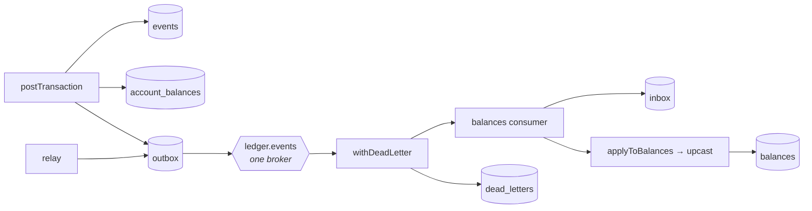
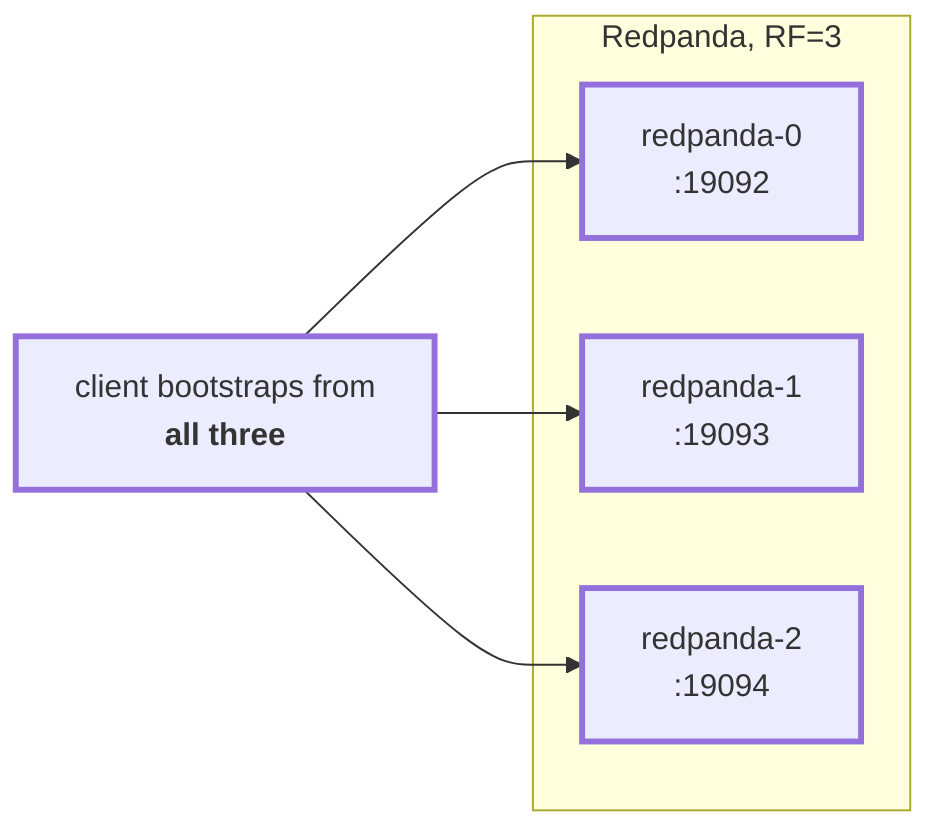
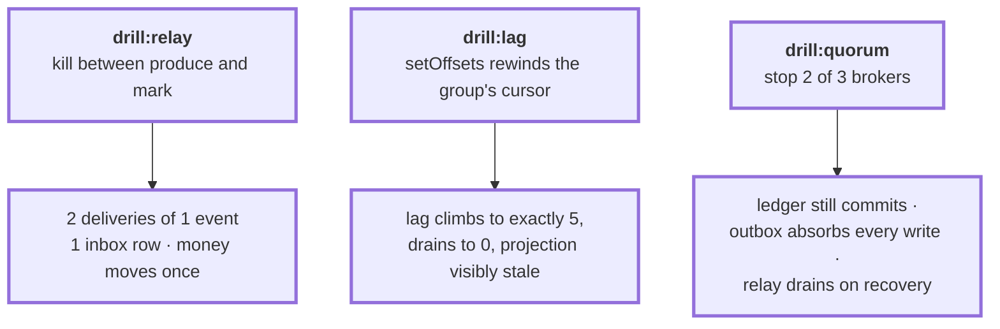
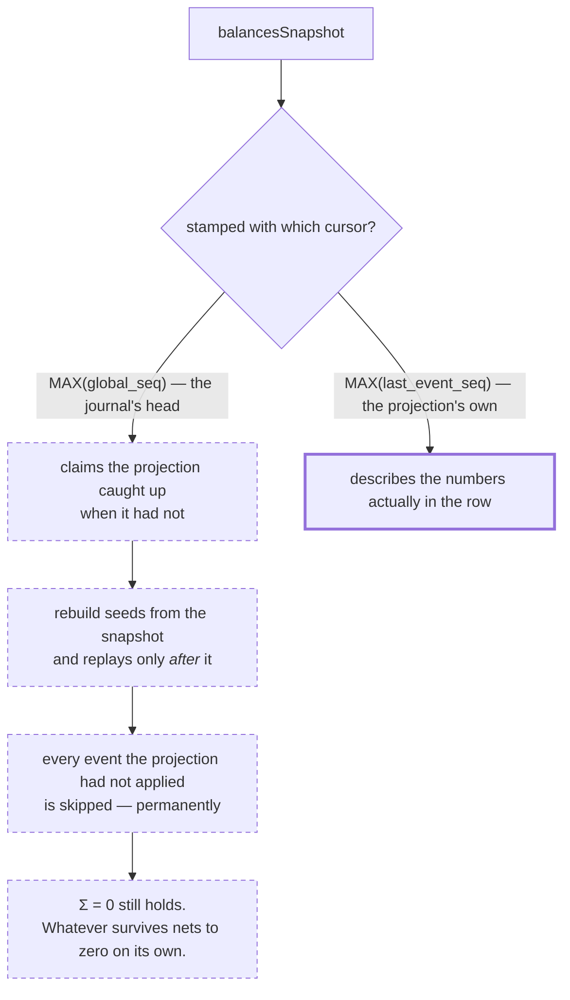
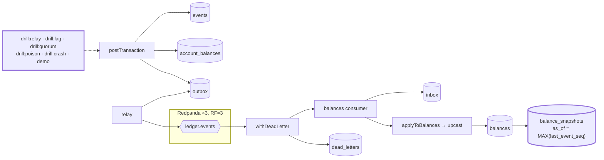

# 2.7 — Stage 2 drills

**Stage:** 2 · **ADRs:** [0008](../decisions/0008-replication-and-quorum.md) ·
[0009](../decisions/0009-snapshot-cursor.md) · **Commit:** `01e0aa9`

> Three brokers, and three scripts that break the system on purpose. Every Stage 2 claim stops
> being an argument and becomes something you can watch fail and recover.

## Before

A single broker cannot lose a quorum, so the durability story has never been tested. Neither has
the duplicate, nor the lag.

## The change — a cluster that can actually lose a majority

Bootstrapping from one broker means one machine's outage looks like a cluster outage.

## The change — three drills

`drill:quorum` **asks the cluster about itself** rather than inferring from a failed connection.
`ECONNREFUSED` to a dead leader proves only that a machine is gone; a *leaderless partition*
proves there was no majority left to elect a replacement. [ADR 0008](../decisions/0008-replication-and-quorum.md).

Each drill gained a markdown companion — diagram, the assertions it makes, and the trap it laid
the first time it was written:
[relay](../../services/ledger/scripts/drills/drill-relay.md) ·
[lag](../../services/ledger/scripts/drills/drill-lag.md) ·
[quorum](../../services/ledger/scripts/drills/drill-quorum.md) ·
[poison](../../services/ledger/scripts/drills/drill-poison.md) ·
[crash](../../services/ledger/scripts/drills/drill-crash.md)

## The change — the bug the repair surfaced

Fixing the demo so the drills could run on it exposed something silently wrong since
[2.3](2.3-projection-behind-the-log.md):

Correct in [1.6](1.6-snapshots.md), because the command wrote balances inside its own
transaction and the two numbers were the same. Wrong from the moment the projection moved
behind the log — and undetectable by the invariant that was supposed to catch it.
[ADR 0009](../decisions/0009-snapshot-cursor.md).

The demo itself had been printing `0.00` for four checkpoints: it reads a table the command
stopped writing in 2.3. It now plays the consumer's part with a cursored replay, and fails
loudly when the rebuilt numbers differ from the ones captured before the wipe.

## After

**End of Stage 2.** Everything above is asynchronous and everything above is recoverable,
because every participant is a system we own — the outbox works precisely because both halves
are ours. Stage 3 removes that.

## What moved

| Before | After |
| --- | --- |
| one broker | three, RF=3, client bootstraps from all of them |
| claims argued | three drills that break the system and assert the recovery |
| snapshot stamped with the journal's head | stamped with the projection's own watermark |
| demo printing `0.00` since 2.3 | demo replays as the consumer and checks itself against a pre-wipe capture |

## What this did not solve

Money still only moves between accounts we own, instantly. 3.1 introduces money that is spoken
for but has not moved yet.
