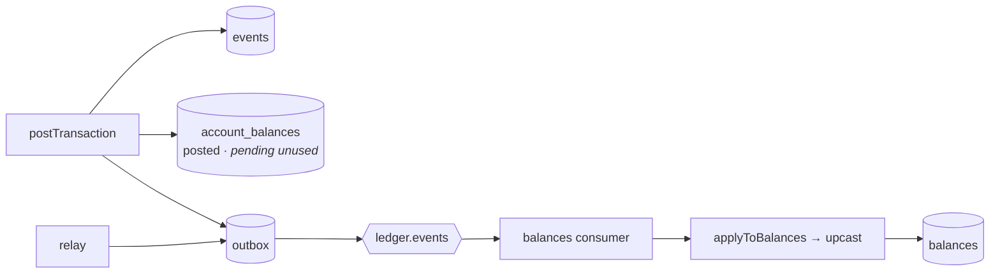
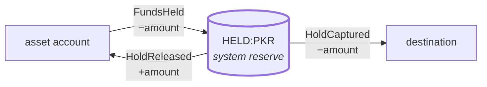
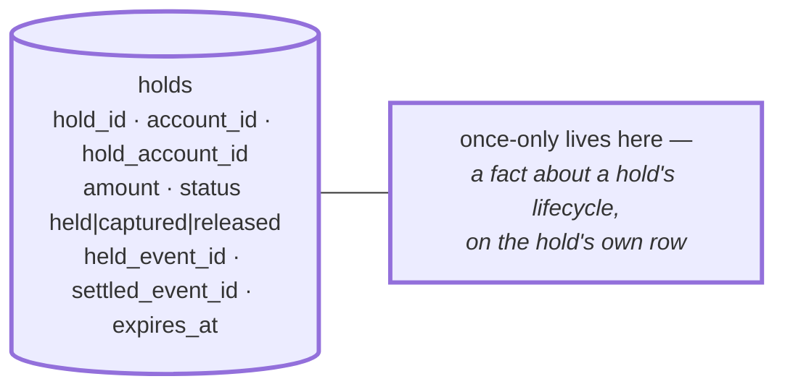
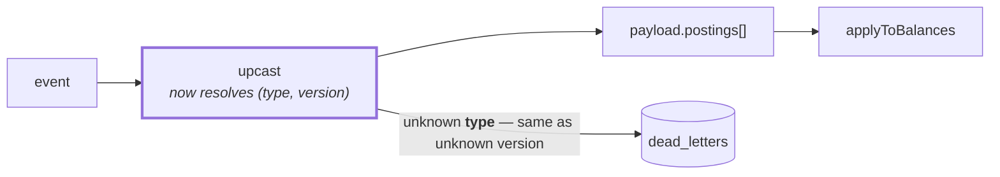
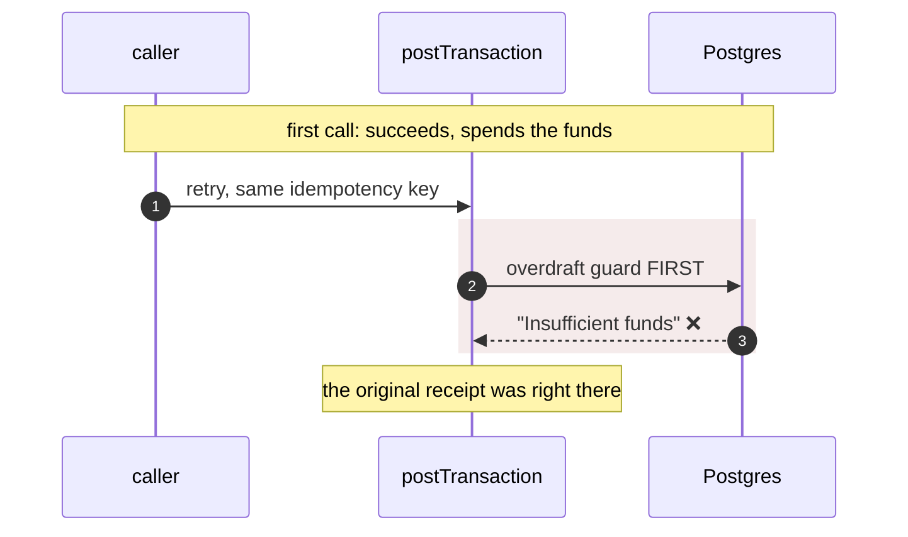
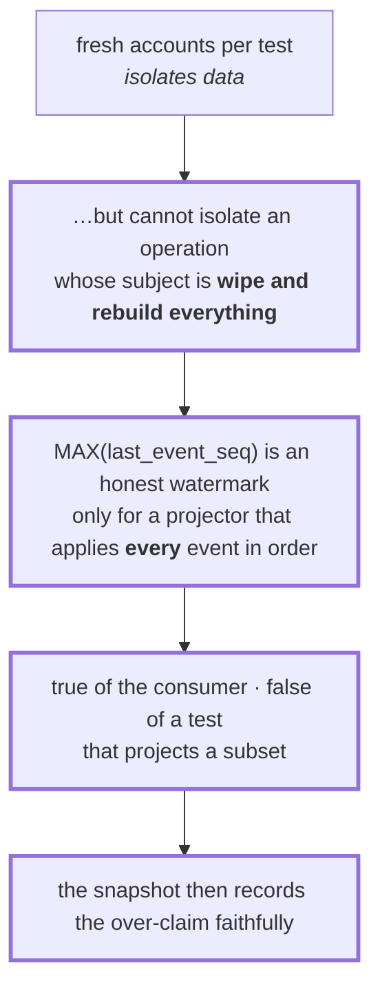
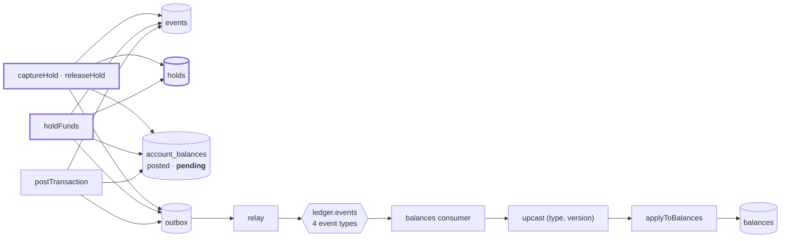

# 3.1 — Holds

**Stage:** 3 · **ADR:** [0010](../decisions/0010-holds-as-postings.md) · **Commit:** `e5b0718`

> Money that is spoken for but has not moved. It is a **posting**, not a column — three new
> balanced event types that replay and audit exactly like every other event.

## Before

`event_type` has been the single literal `TransactionPosted` since 1.2, and
`account_balances.pending` has been an unused column since [2.3](2.3-projection-behind-the-log.md).
Both are about to be spent.

## The change — a hold is a posting to a reserve

Three events, each Σ = 0, each replayable. The alternative — a `held_amount` column on the
balance row — is a fact about money that the journal does not contain, so a rebuild could never
reproduce it.

Two consequences of the reserve being a **system account per currency**:

- Holds do not serialise on one locked row. Same reasoning as
  [1.3](1.3-post-transaction.md)'s exemption-before-the-lock, now load-bearing for throughput.
- The overdraft guard's *available* becomes `posted + pending`, and `pending` is finally the
  seam it was reserved to be — the day ledger and available balances have to differ.

## The change — the projector never learns there are four types

Every one of the four payloads carries `postings`, so downstream of `upcast` nothing changed at
all. [2.6](2.6-schema-evolution.md) resolved a *version*; it now resolves a *pair*, and an
unknown type dead-letters by the same route as an unknown version.

## The change — a bug latent since 1.4

The guard ran before the replay check. Invisible to the [1.4](1.4-idempotency.md) concurrency
test, because both of its callers race *before* balances move — so the replaying caller never
met a balance the original had already spent. The fix is the two checks now at the top of
`postTransaction`: a `SELECT` for *retry later*, `ON CONFLICT` for *retry now*.

## The change — five rebuild tests that were order-dependent

Green under the default file order, failing under shuffle. The same watermark question as
[ADR 0009](../decisions/0009-snapshot-cursor.md), arriving from the other direction.

## After

## What moved

| Before | After |
| --- | --- |
| one event type | four — `TransactionPosted`, `FundsHeld`, `HoldCaptured`, `HoldReleased` |
| `pending` unused | `pending` is the reserve's shadow; available = `posted + pending` |
| — | `holds` table owns the once-only invariant for a hold's lifecycle |
| `upcast` resolves a version | `upcast` resolves `(type, version)`; unknown type dead-letters |
| overdraft guard before replay check | replay checks first — a retry returns the receipt |

## What this did not solve

A hold is one transaction in our own database. The moment the next step is a call to somebody
else's bank, atomicity stops being available at all. 3.2.
