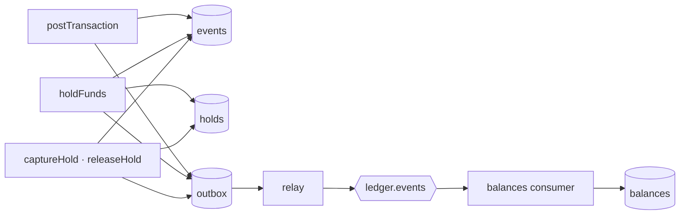
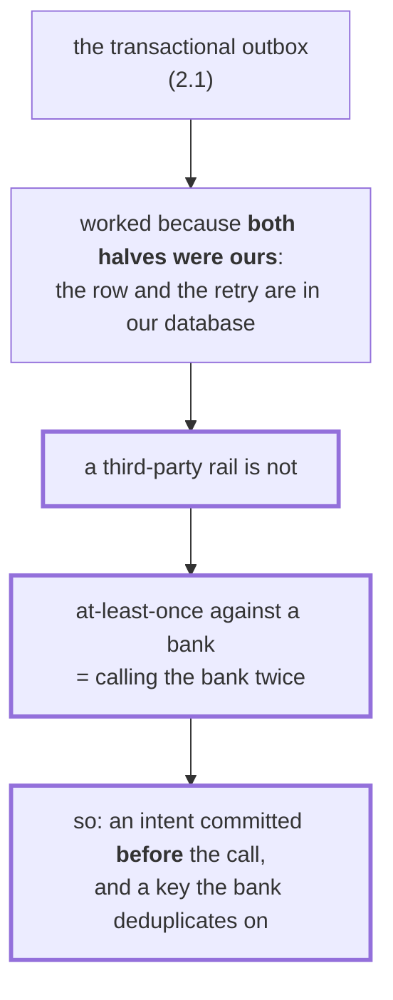
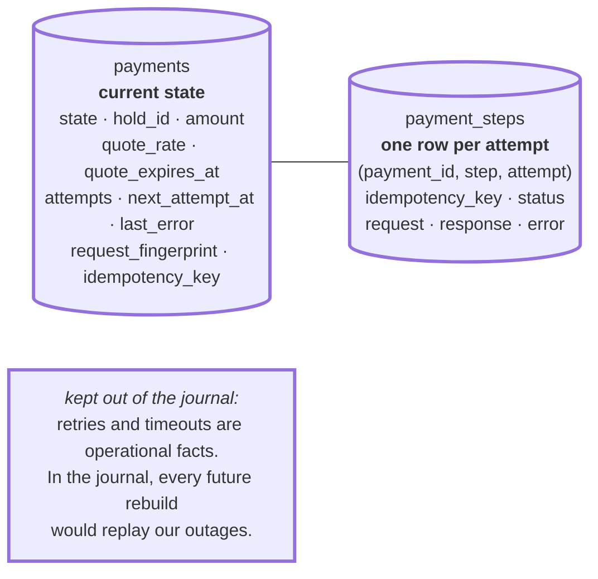
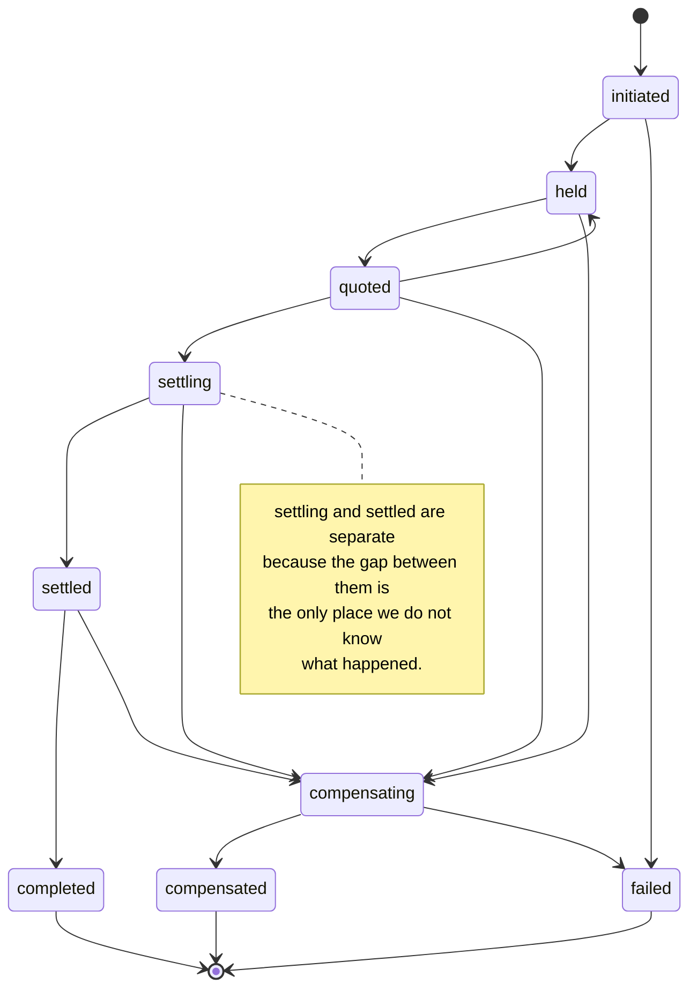
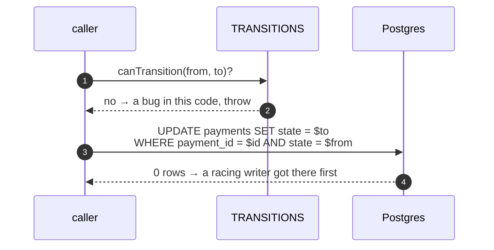
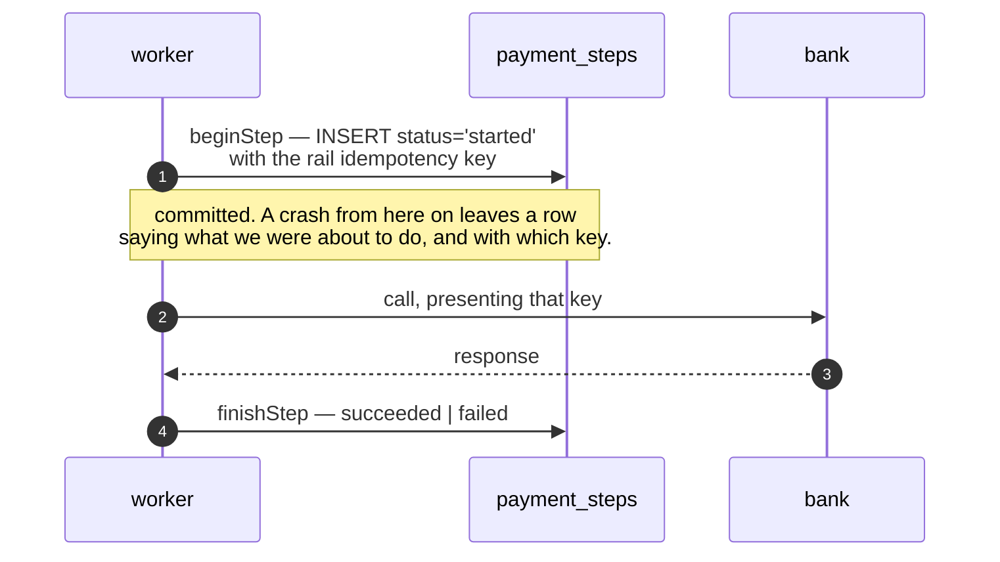
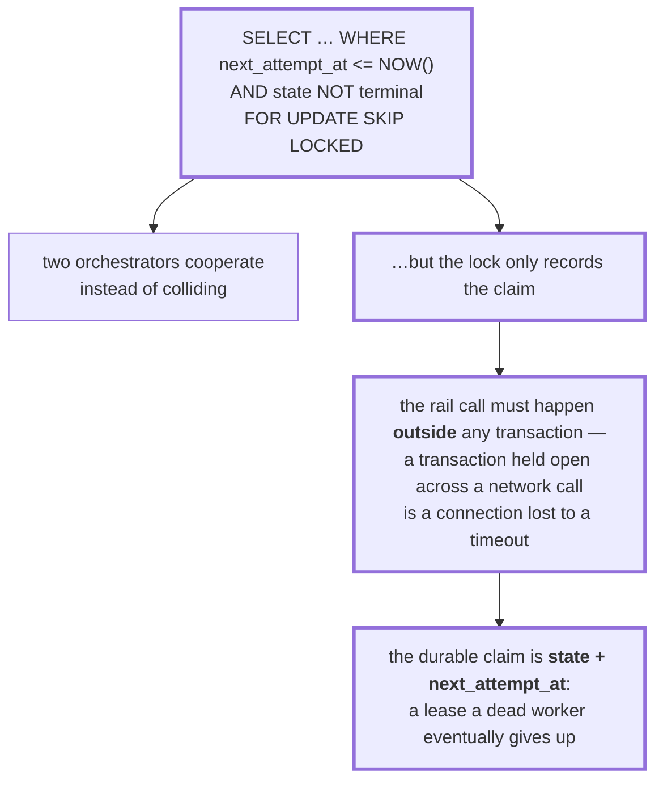
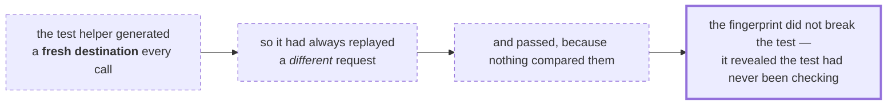
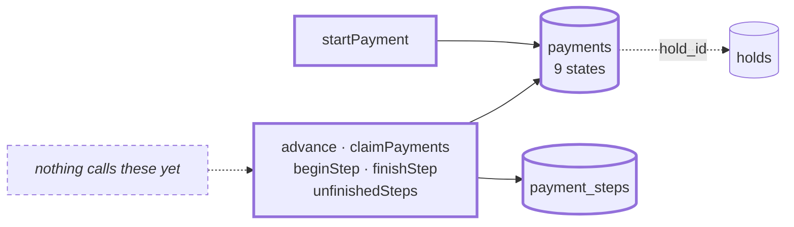

# 3.2 — Saga state

**Stage:** 3 · **ADR:** [0011](../decisions/0011-saga-state.md) · **Commit:** `959033d`

> The dual-write problem returns, and the outbox cannot solve it this time. What replaces
> atomicity is an intent committed *before* the call and a key the bank honours.

## Before

## The change — why the outbox does not work here

## The change — two tables, and why they are not events

## The change — nine states, each naming a crash window

A state is not a phase — it is **a crash window that recovers differently from its neighbours**.
That rule is what keeps the list at nine, and it is why there is no `quoting`: crashing
mid-quote recovers by asking again, exactly like `held`.

Terminality is *derived* from the table — a state with no outgoing edges — rather than declared
in a list beside it, so the two cannot disagree.

## The change — transitions checked twice

Two different failures. TypeScript catches *we wrote the machine wrong*; the compare-and-set
`WHERE state = $from` catches *someone else moved it while we were deciding*. Neither check
can do the other's job.

## The change — the key is committed before the call

**`stepKey = paymentId:step` — per step, not per attempt.** A retry that invents a new key is a
second payment as far as the bank is concerned. Deriving it rather than generating it means a
recovering worker can reconstruct it from the row without storing it anywhere else.

## The change — claiming, and where the lock stops

## The change — the test that had never been checking

Adding a `request_fingerprint` failed **`it("is idempotent on the caller's key")`** on its first
run:

## After

## What moved

| Before | After |
| --- | --- |
| — | `payments` (current state) and `payment_steps` (one row per attempt) |
| — | nine states, each naming a crash window; terminality derived from the table |
| — | transitions checked twice: in TypeScript, and as compare-and-set in SQL |
| — | `beginStep` commits the rail key before the call; the key is per step |
| — | `SKIP LOCKED` claim; the durable lease is `state + next_attempt_at` |
| — | `request_fingerprint`, which caught a test that had never compared anything |

## What this did not solve

Nothing drives it. There is a machine and no driver — 3.3.
