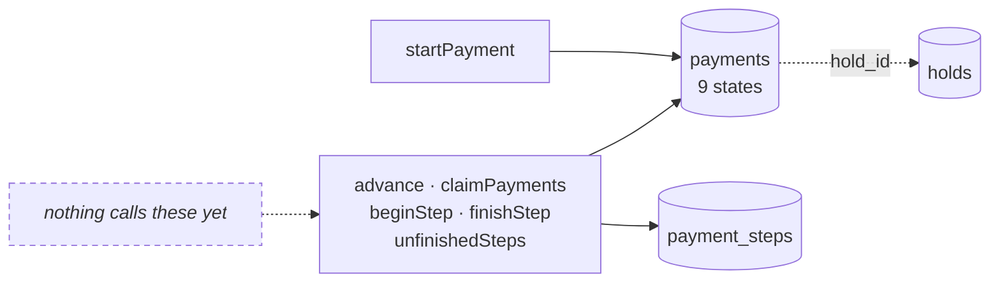
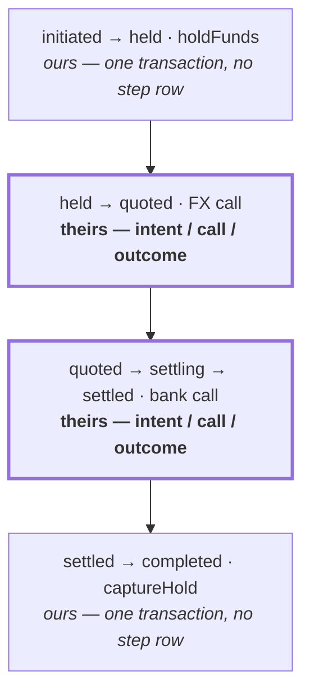
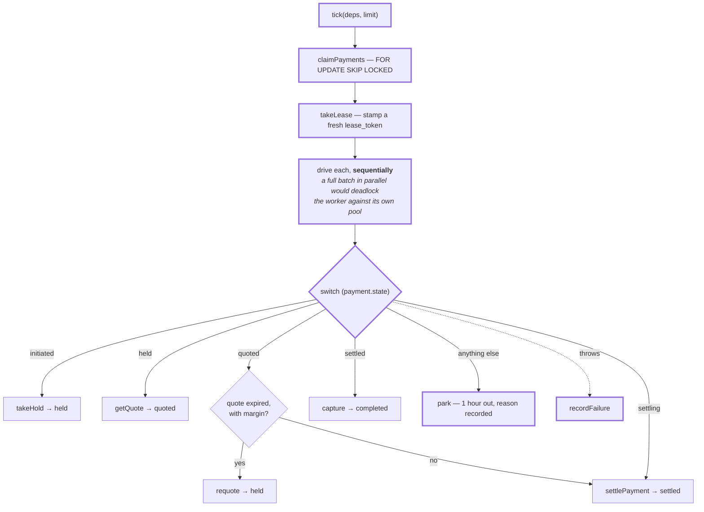
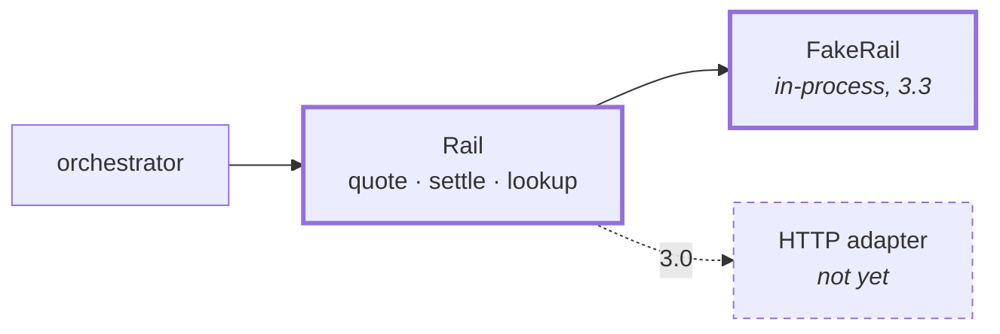
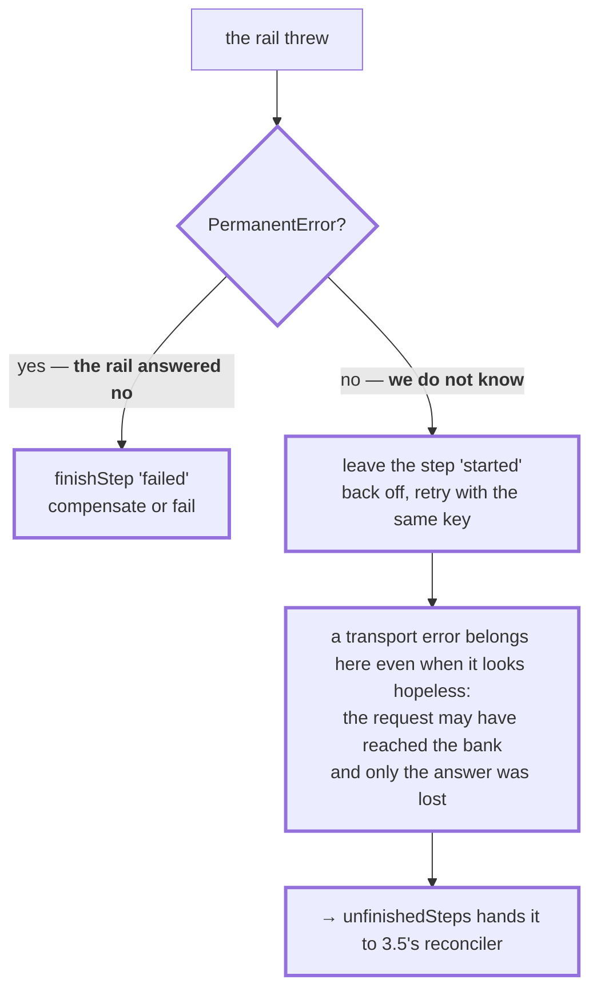
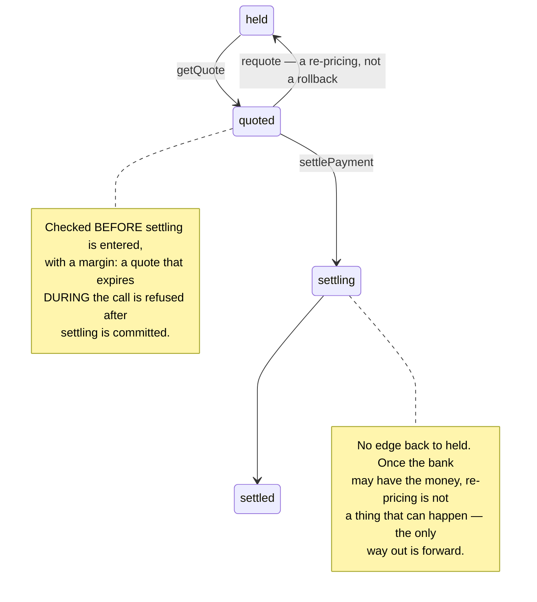
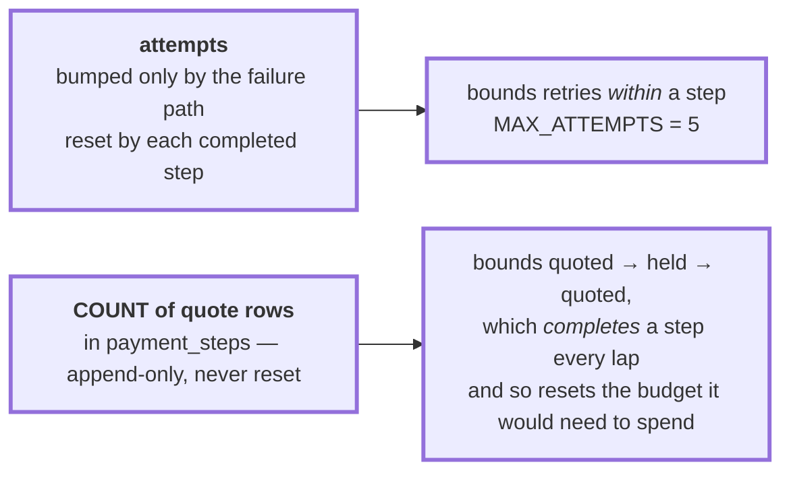
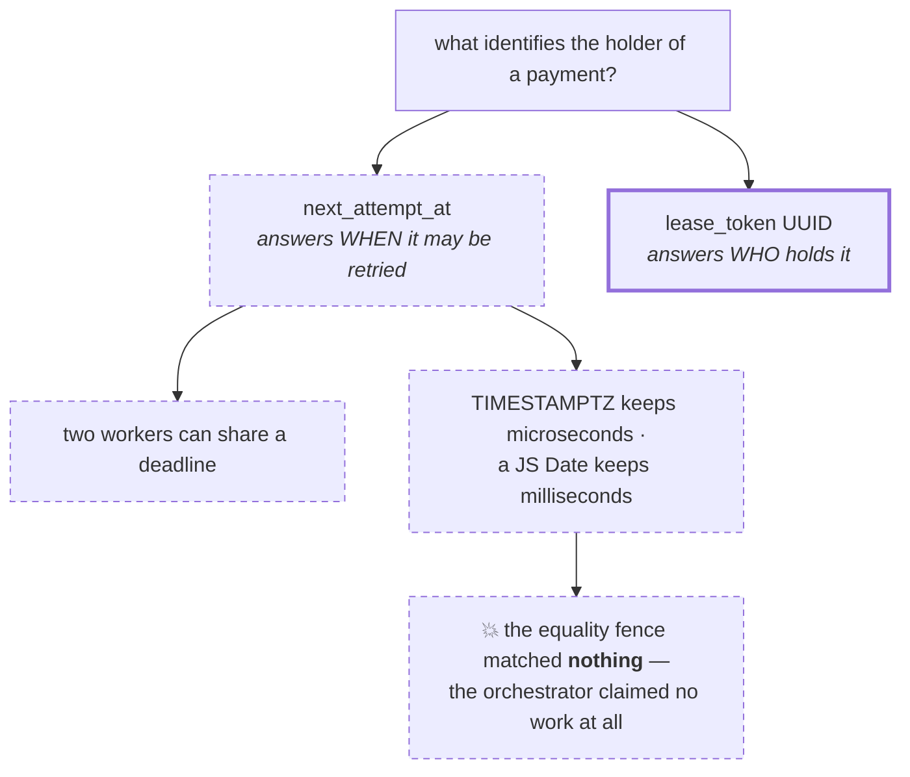
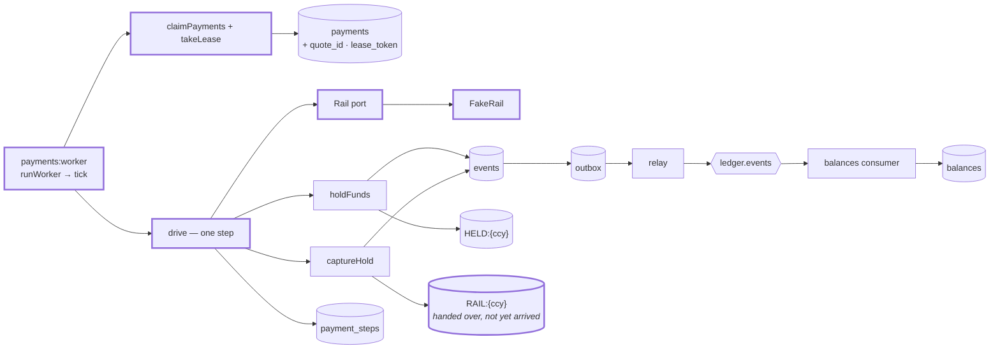

# 3.3 — The orchestrator

**Stage:** 3 · **ADR:** [0012](../decisions/0012-orchestration.md) · **Commit:** `89100f2`

> `hold → quote → settle → commit`, one step per tick — and only half of it is a saga, because
> the hold and the capture are writes to our own database.

## Before

[3.2](3.2-saga-state.md) built the machine and drove nothing.

## The change — saga machinery only where atomicity is unavailable

The begin/act/finish dance is the expensive answer to *you cannot atomically call a bank and
record that you called it*. Where both halves are ours, atomicity is still available, and using
the saga shape anyway would be ceremony that **opens a crash window that did not have to exist**.

`quote` gets a step row but **no state** — 3.2's own rule applied honestly. Crashing mid-quote
leaves the payment in `held` with an unfinished quote step, and the recovery is *ask again*,
because a quote moves no money. That is why there is no `quoting`.

## The change — a tick advances one step

**There is no "run this saga" function.** There is only *advance this payment by one step*, and
that is what makes **the resumer and the driver the same code**. A payment claimed in `settling`
is not a recovery path — it is this switch, on that state, doing what it always does. Nothing
in the orchestrator can tell a fresh payment from one a dead worker left behind, so there is no
second code path to keep correct.

`settling` is the middle of the settle step, not a resting place, so one tick carries a payment
through it. The states a tick *ends* on are the ones where stopping is safe.

## The change — the rail as a port

`lookup` is declared and **deliberately unused** — it is the question 3.5 exists to ask, and a
port that cannot ask it is a port 3.5 would have to change.

A fake's failure mode is being *more permissive* than the thing it stands in for, so this one
refuses an unknown quote, an expired one, a settlement that does not match its quote, a target
amount truncated to zero, and a key reused for a different request. Every check it skipped would
be a test that proved nothing — which is exactly how [3.2](3.2-saga-state.md)'s idempotency test
passed while replaying a different request every run.

One place it is deliberately permissive, and it is load-bearing: it will **issue a new quote
under a key it has already answered**, once the old one expired. A strictly key-idempotent rail
would return the same dead quote forever and re-pricing could never get a new price.

## The change — the error contract

This is narrower than "will a retry help". Stamping an ambiguous transport failure as a learned
refusal empties `unfinishedSteps` and releases the hold **while the bank has already paid**.

## The change — an expired quote goes back to `held`

The consequence is real and correct: **a settlement that never landed, whose quote has since
expired, cannot be retried.** It compensates, and the customer re-initiates at a new price.

## The change — two budgets, because there are two shapes of loop

Two counters looked like duplication until one of them could not do the other's job. Bumping
`attempts` on successful moves reached the first settle with the budget three-fifths spent, and
abandoned healthy payments after two rail attempts.

## The change — the lease is a token, not a deadline

`reschedule` and `advance` fence on `lease_token IS NOT DISTINCT FROM $n`, so a worker that woke
up after its lease was taken cannot write. And `recordFailure` re-reads the row rather than
fencing on the state it was claimed with — **the state at failure is not the state at entry**,
because the settle handler commits `settling` before the call.

## After

## What moved

| Before | After |
| --- | --- |
| a machine with no driver | `tick` claims what is due and advances each payment one step |
| — | `RAIL:{ccy}` system clearing accounts, one per currency |
| — | `Rail` port + strict in-process `FakeRail`; 3.0 substitutes HTTP |
| — | `quote_id` on `payments`, so the settle request is a pure function of the row |
| — | `lease_token`, because `next_attempt_at` answers a different question |
| — | `convert` in `@ledgerrail/money`, where the per-currency exponent lives |
| `attempts` conflated with progress | per-step budget, reset by each completed step |

## What this did not solve

- **The happy path is proven; no timeout is.** A fake that always answers instantly cannot
  exercise a slow call, a lost response or a partition. Stage 4.
- **`compensating` has no handler** — it is parked an hour out with the reason recorded, which
  makes 3.4 a pure addition rather than an edit.
- **FX is priced but not posted.** The ledger moves source currency into `RAIL:{ccy}`; the rate
  and target amount are workflow facts. Cross-currency postings need an FX position account, a
  per-currency Σ = 0, and a rounding-residual policy — and `assertPostable` currently sums Σ
  across all legs regardless of currency, which is fine only while nothing posts two.
