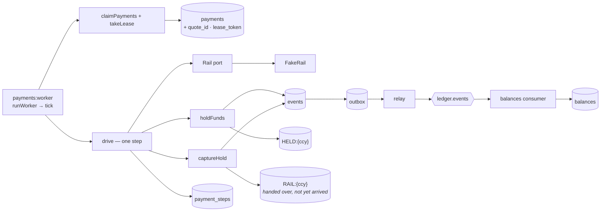
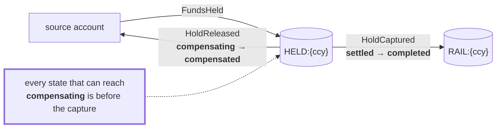
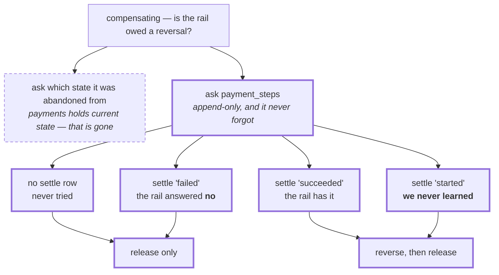
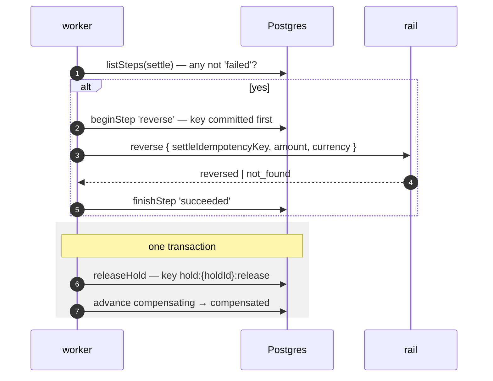
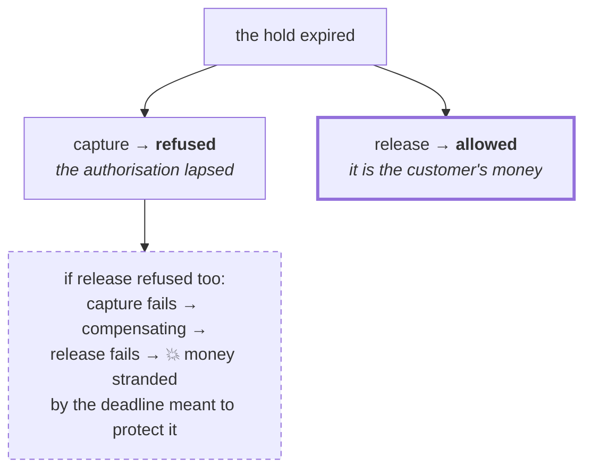
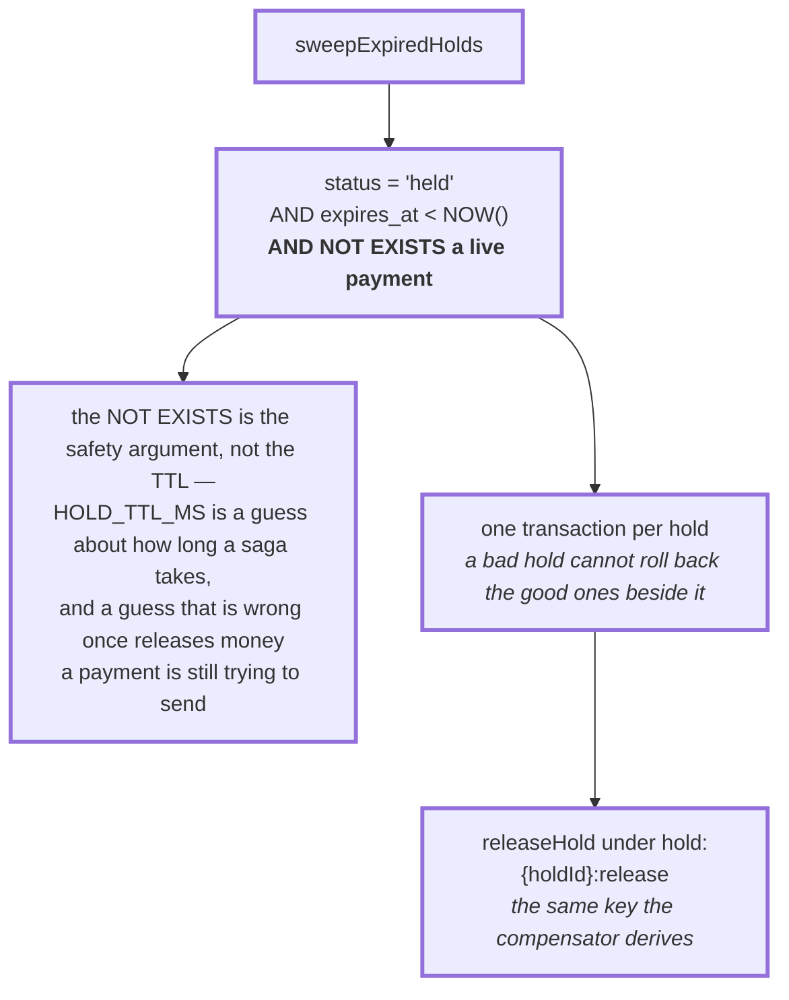
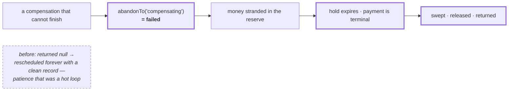
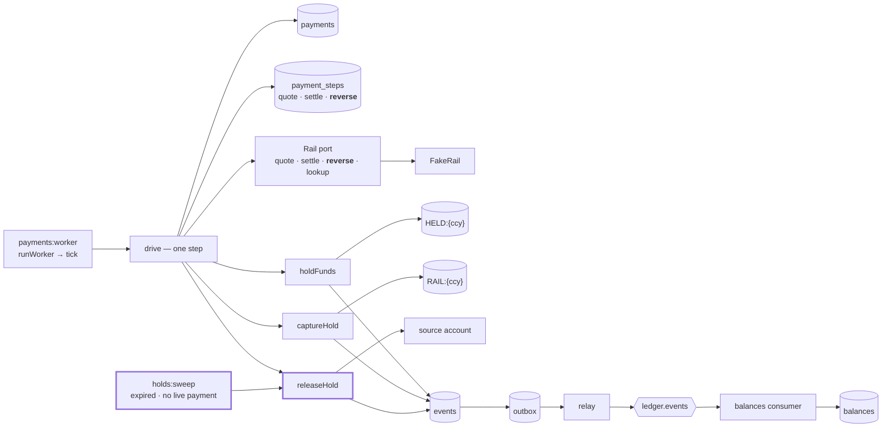

# 3.4 — Compensations

**Stage:** 3 · **ADR:** [0013](../decisions/0013-compensations.md) · **Commit:** _pending_

> `compensating` stops being a parking space. The rail is asked to send the money back, the reserve
> is emptied by a posting the ledger already had, and a sweeper stands behind the whole thing.

## Before

Every abandonment past `initiated` lands in `compensating`, and `compensating` has no handler — it
is parked an hour out with the reason recorded, forever, and the customer's money stays in the
reserve.

## The change — where the money actually is

Everything else follows from this, so it goes first.

`RAIL:{ccy}` receives only at completion, and `completed` is terminal. So a compensation never pulls
money back out of the clearing account — it asks the rail to send it back and empties the reserve
with `HoldReleased`, which has existed since [3.1](3.1-holds.md).

**3.4 adds no event type.** Nothing is deleted and no event is amended: the settle that may have
moved the money stands in the journal beside the reversal that answered it. You cannot un-send
money; you send it back.

The boundary that falls out: reversing a **completed** payment is a refund, not a compensation — a
new transaction in the other direction, and `completed` keeps its empty row in the table.

## The change — how the compensator knows whether to call the rail

The `started` branch is the whole rule. **"May have" is treated exactly like "is"** — the same
distinction `callRail` enforces when it refuses to stamp a transport error as a learned refusal,
which is why the predicate is `status !== "failed"` and not `status === "succeeded"`.

## The change — the compensation itself

Three things the picture is carrying:

- **The settlement is named by its key, not its reference.** `stepKey(paymentId, "settle")`, derived
  from the row. The reference is the version that cannot work — a settle whose answer was lost has
  none, and that is exactly the settlement this exists to reverse.
- **`not_found` is an answer, not an error**, and therefore a *succeeded* step. We asked, and
  learned there was nothing there. A compensator punished for asking has to guess instead.
- **`last_error` is carried, not cleared.** `advance` wipes it on a successful move, which is right
  everywhere else. Why this payment did not go through is the only thing anyone will ever ask a
  compensated row.

## The change — expiry bounds holding, not returning

Both refusals became `PermanentError` at the same time: `status` never returns to `held` and time
only moves forward, so no retry can help either — and left transient they burned the whole budget
first. Settling a hold now also checks for a replay **before** claiming it, an ordering that has
been wrong since [3.1](3.1-holds.md) and could not be reached until something called release twice.

## The change — the sweeper, and the loop it closes

And the reason it matters beyond tidying up:

**The sweeper is what makes `failed` an available answer at all.** Without it the orchestrator is
choosing between a hot loop and losing a customer's money.

## After

## What moved

| Before | After |
| --- | --- |
| `compensating` parked an hour out, forever | driven to `compensated` — reverse if owed, then release |
| the origin state would have to be remembered | `payment_steps` answers it, append-only |
| — | `Rail.reverse`, keyed on the settle's own idempotency key |
| `abandonTo("compensating")` → `null`, retry forever | → `failed`, with the sweeper behind it |
| abandonment kept the spent budget | abandonment resets `attempts` |
| release refused an expired hold | expiry bounds holding, not returning |
| settle-a-hold claimed before checking for a replay | replay first, as `holdFunds` has done since 1.4 |
| — | `holds:sweep`, and a partial index on `payments(hold_id)` |

## What this did not solve

A reverse whose own answer is lost leaves a `started` step, exactly as a settle does — and nothing
yet asks the rail what it believes happened. `lookup` has been declared and unused since
[3.3](3.3-orchestrator.md) waiting for it. That is 3.5.
