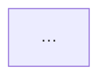
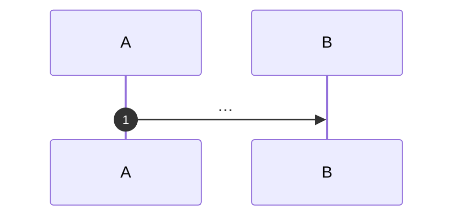

# N.M — Title

**Stage:** N · **ADR:** [00XX](../decisions/00XX-slug.md) · **Commit:** `abc1234`

> One sentence. What is true after this checkpoint that was not true before it.

## Before

Copy the previous checkpoint's *After* diagram, unedited. If it has to be edited to be true,
say so here — that is a finding, not a formatting fix.

What is missing, named as a question this checkpoint answers.

## The change

The mechanism drawn as itself — a sequence if it is an ordering, a state machine if it is a
lifecycle, a race if it is a race. Not the component diagram again.

## After

The *Before* picture with what moved marked `new`, and anything that stopped being written
marked `gone`.

## What moved

| Before | After |
| --- | --- |
| … | … |

## What this did not solve

The thing the next checkpoint exists for.
