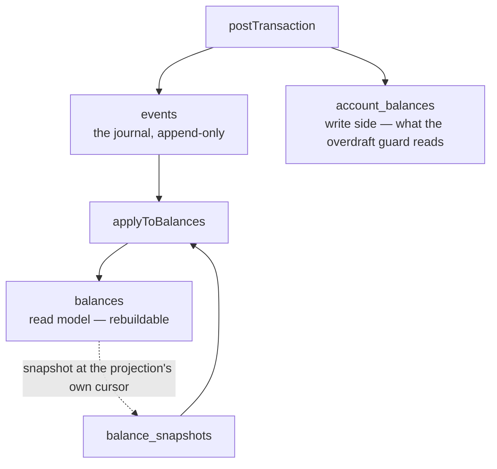

# demo — the whole architecture as one narrative

```bash
pnpm demo
```

Not a drill. This is the ledger telling its own story end to end: fund an account, move money
between two, watch an invariant refuse a bad transfer, retry a command and get the original result
back — then snapshot the projection, destroy it, and rebuild it from the journal alone.

The last step is the claim everything else rests on: **balances are derived**. If the numbers after
a rebuild differ from the numbers before it, every drill in `drills/` is measuring the wrong system.

## What happens

```mermaid
flowchart LR
    A["create accounts<br/>1 system, 2 asset"] --> B["fund<br/>system → asset A"]
    B --> C["transfer<br/>asset A → asset B"]
    C --> D["overdraft<br/>rejected, on purpose"]
    D --> E["replay an idempotency key<br/>same event returned"]
    E --> F["project + snapshot"]
    F --> G["3 more transactions<br/>projection now lags"]
    G --> H["project again<br/>capture 'before'"]
    H --> I["delete balances"]
    I --> J["rebuild from the journal"]
    J --> K["identical numbers"]

    classDef good stroke-width:2px
    classDef gone stroke-dasharray:5 4
    class D,E,K good
    class I gone
```



The write side and the read side are different tables with different writers:



Since 2.3 the command **does not touch `balances`** — the consumer owns it. No consumer runs during
the demo, so the demo plays that part itself via `project()`.

## Step by step

| # | Code | What it shows |
|---|------|---------------|
| 1 | `createAccount("system")`, `×2 asset` | Money enters a conserved ledger by debiting a **system** account, the only one allowed to go negative. A positive balance anywhere requires a negative one somewhere. |
| 2 | fund 100 | System −100, asset A +100. Σ = 0. |
| 3 | transfer 40 | A → B, both non-negative afterwards. |
| 4 | overdraft 140, inside a `try` | Rejected by the guard, which reads the **write-side** `account_balances` — an invariant cannot be enforced against a lagging projection. Printing "Overdraft succeeded" would be the failure. |
| 5 | replay a used idempotency key | Returns the **same** event id and global sequence: no second posting, no balance movement. |
| 6 | `project(client)` | Plays the consumer's part, resuming from `MAX(last_event_seq)` so repeated calls never re-apply a range. |
| 7 | `balancesSnapshot` | Stamps every account against one global cursor — the projection's watermark, not the journal's head. |
| 8 | three more transactions | Written but not yet projected: the balances printed here are **legitimately stale**, three events behind the write side. |
| 9 | `project(client)` again | The projection catches up; `before` is captured from it. |
| 10 | `DELETE FROM balances` | The read model is disposable because it is derivable. |
| 11 | `rebuildBalances` | Seeds from the latest snapshot and replays only the events after it — the bounded rebuild, exercised rather than described. |
| 12 | `fingerprint(before) === fingerprint(after)` | The claim. Amounts, not row counts. |

## Gotchas

- **`rebuildBalances` is global**; the wipe above it is scoped to three accounts. The rebuild
  deletes *all* balances and replays the whole journal, so running the demo rewrites every account
  from the events. That is safe only because balances are derived — which is the property being
  demonstrated.
- **A snapshot must be stamped with the projection's cursor, not the journal's head.** Stamping
  `MAX(global_seq) FROM events` claims the projection had caught up when it may not have, and a
  later rebuild then seeds from that point and replays only what came after — silently dropping
  every event the projection had not yet applied. Σ = 0 still passes, because whatever survives
  nets to zero on its own. This bug shipped and was found by this demo.
- **Comparing row counts proves nothing.** A rebuild that recomputes every balance as zero keeps the
  cardinality identical. Compare values.
- **`project()` must resume from a cursor.** Replaying from 0 twice double-applies every delta in
  the database, because `applyToBalances` adds rather than sets.
- **A health check is `pool.query("SELECT 1")`, never `pool.connect()`.** A checked-out client makes
  `pool.end()` wait forever, so the demo does all its work correctly and then refuses to exit.
- The snapshot uses one global cursor read once. A per-account `last_event_seq` looks equivalent and
  silently drops every account not at the maximum.

## A passing run

```
Funding Asset          → Global Seq = 24
Making a transfer      → Global Seq = 25
Overdraft rejected
Replaying a duplicate idempotency key
↳ replay returned the SAME event (no new posting)
Taking a snapshot
Projecting the events onto balances
Making some transactions → 27, 28, 29
[Balance] System : -1.00   Asset A : 0.60   Asset B : 0.40     ← projection lagging
Projecting the new events
[Balance] System : -1.00   Asset A : 0.30   Asset B : 0.70     ← caught up
Wiping balances
[Balance] System : 0.00    Asset A : 0.00   Asset B : 0.00
Rebuilding from the journal
[Balance] System : -1.00   Asset A : 0.30   Asset B : 0.70
↳ rebuilt from the journal — identical numbers
```

## Related

- [ADR 0002](../../../docs/decisions/0002-overdraft-locking.md) — the lock behind the rejected overdraft
- [ADR 0004](../../../docs/decisions/0004-write-side-balances.md) — why the guard reads a write-side table
- The drills in [`drills/`](drills/) — the same system, interrupted on purpose
