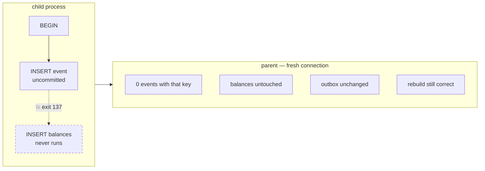

# drill:crash — kill the process mid-transaction

```bash
pnpm drill:crash
```

A proxy around the injected client hard-kills the child process between the event insert and the
balance write. The parent then checks, from a connection that knows nothing about the corpse, that
neither half survived.

Fault injection needed **no change to the ledger** — wrapping the injected client was enough,
which is the dependency-injection decision paying for itself.

## What happens



No `COMMIT` ever runs, so Postgres discards the whole transaction. The ledger is either correct or
unchanged — there is no third state to repair.

## Step by step

| # | Code | Why |
|---|------|-----|
| 1 | `createAccount ×2` | Fresh accounts, created **by the parent** and passed down, so the parent verifies the accounts the child actually touched. |
| 2 | `getEvents`, `getBalances`, outbox count | The "before" reading, from the parent's own pool. |
| 3 | `spawn(tsx, [self, "--child", …])` | The child re-runs this file with the ids and idempotency key as arguments. |
| 4 | `crashOn(client, "INSERT INTO balances")` | A `Proxy` over the injected client that calls `process.exit(137)` when it sees the marker SQL — after the event insert, before the balance write. |
| 5 | `code !== 137 → throw` | The exit code is the one we chose, not merely non-zero. |
| 6 | event count unchanged | The uncommitted event is gone. |
| 7 | outbox count unchanged | The outbox row went with it — one transaction, one outcome. |
| 8 | `rebuildBalances` | The journal was never polluted, so a replay still reproduces the right numbers. |

## Gotchas

- **Assert exit code 137 exactly, not "non-zero".** A child that dies on an unresolvable import
  also exits non-zero and looks exactly like a passing drill. Both happened here before this
  assertion existed.
- **Await the child.** An un-awaited spawn means the "after" reading happens before anything was
  attempted — reassuring output, no information.
- **Pass the account ids down.** The child originally created its own accounts, so the parent
  spent a run verifying accounts nothing had ever touched.
- **Run the child through `tsx`, not bare `node`.** Node strips types but does not remap
  specifiers, so `./db.js` must resolve to a real `db.js`; under bare `node` the child dies on
  module resolution, non-zero, and looks like the crash you injected.
- **Release clients in `finally`.** A thrown query that leaks a client makes `pool.end()` wait
  forever, so the drill hangs instead of reporting, and the real error never prints.

## A passing run

```
Creating accounts
[Balance] System : 0.00 PKR
[Parent] Spawning myself (PID: …)
[Child] Hello from inside the child process! (PID: …)
Initiating transaction in child process
💥 killing process before: INSERT INTO balances
[Parent] child exited with 137
Events 0
[Balance] System : 0.00 PKR
Rebuilding balances
```

## Related

- [ADR 0002](../../../../docs/decisions/0002-overdraft-locking.md) — the invariant this transaction
  is protecting while it runs
- [ADR 0003](../../../../docs/decisions/0003-outbox-and-event-partitioning.md) — why the outbox row
  must share the event's transaction
