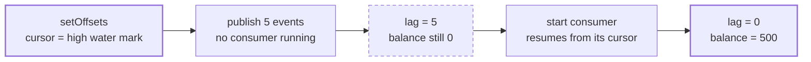

# drill:lag — build and drain consumer lag

```bash
pnpm drill:lag
```

Seeds a consumer group's cursor at the end of the log, publishes five events with nothing
consuming, and watches lag appear as a number while the projection visibly falls behind. Then
starts the consumer and watches both go away.

**Run with the balances consumer stopped.** `balances` has exactly one writer
([ADR 0004](../../../../docs/decisions/0004-write-side-balances.md)), and for the length of this
drill that writer is the drill.

## What happens



The measurement itself, summed across every partition:

```mermaid
flowchart TB
    P0["partition 0<br/>high 5 − committed 2 = 3"] --> S["lag = 5"]
    P1["partition 1<br/>high 1 − committed 1 = 0"] --> S
    P2["partition 2<br/>high 6 − committed 4 = 2"] --> S
```



Five events landed across two partitions. Reading partition 0 alone would have reported 3.

## Step by step

| # | Code | Why |
|---|------|-----|
| 1 | `drainOutbox` | Publishes anything an earlier run left pending, **before** the cursor is seeded — otherwise those messages land after it and count as lag this drill did not create. |
| 2 | `admin.setOffsets` | Gives the group a cursor at the high water mark of *every* partition. Also the tool you would use to rewind a group and rebuild a projection. |
| 3 | `lagFor(...) === 0` | Establishes the precondition, and checks the partition count as well as the sum. |
| 4 | `postAndRelay ×5` | Events committed and published with no consumer running. |
| 5 | `lagFor(...) === BACKLOG` | Lag is exactly 5, summed across partitions. |
| 6 | `balanceOf(assetId) === 0n` | The projection is genuinely stale, not just "a number is small". |
| 7 | `start()` | The consumer joins and resumes from the seeded cursor. |
| 8 | `lagFor(...) === 0`, `balance === 500n` | It caught up, and lost nothing on the way. |

## Gotchas

- **A warm-up message cannot seed three partitions.** A consumer commits offsets only for
  partitions it has actually read from, so one message leaves the other two with no cursor — and
  lag against a partition with no cursor is *undefined*, not zero. This is why the drill uses
  `setOffsets` instead of consuming a message first.
- **`-1` means "never committed", not an offset.** Subtracting it reports a lag one larger than
  the partition, which reads like an off-by-one bug in your own code for half an hour.
- **Check the partition count, not just the sum.** A sum over an empty list is zero, so a group
  that does not exist reports itself perfectly caught up — and the assertion whose job is to
  establish the precondition would pass precisely when the precondition is absent. Same shape as
  the Stage 1.6 finding: an invariant satisfied by a subset.
- **Lag is per partition.** The events scatter by key; sum across all of them.
- `setOffsets` requires the group to have no active members, which is why it runs before the
  consumer starts. kafkajs implements it by joining the group as a paused consumer and leaving
  again — that is the extra `[Consumer] Starting` and the few seconds' pause in the log.

## A passing run

```
[DRILL] ok — the group starts caught up on every partition
[DRILL] publishing 5 events with no consumer running
[DRILL] ok — lag built to exactly 5
[DRILL] ok — the read model is stale — the write side moved, the projection has not
[DRILL] starting the consumer
[DRILL] ok — lag drained back to zero
[DRILL] ok — the projection caught up (balance 500)

[DRILL] passed — a paused consumer builds lag and loses nothing
```

## Related

- [ADR 0004](../../../../docs/decisions/0004-write-side-balances.md) — one writer for `balances`
- [ADR 0005](../../../../docs/decisions/0005-consumer-inbox.md) — why replaying costs nothing
