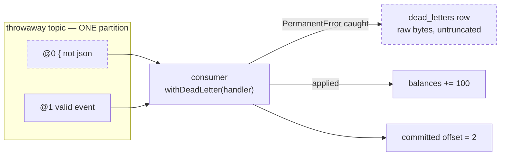

# drill:poison — a poison message must not block the partition

```bash
pnpm drill:poison
```

Produces a message that can never be parsed and a good one directly behind it on the **same
partition**. The assertion is not that the bad one was recorded — it is that the group's committed
offset moved past it.

The unit tests can only prove the handler returns normally. What actually unblocks the partition is
kafkajs committing the offset when `eachMessage` resolves, and no test runs kafkajs.

## What happens



`2` is the only value that means both messages are behind the cursor. `1` would mean it cleared the
poison and stalled on the good one.

## Step by step

| # | Code | Why |
|---|------|-----|
| 1 | `createTopic(topic, 1, 1)` | A throwaway topic with exactly **one** partition, fresh per run so offsets start at 0 and the group has no cursor to inherit. |
| 2 | `postEvent` | A real event row, so the good message survives `inbox.event_id`'s foreign key. |
| 3 | `producer.send([poison, good])` | Order is the point: the unreadable one first. Uses the raw kafkajs producer, because `ProducerHandle` is typed to an `EventEnvelope` and the drill needs to send something that deliberately isn't one. |
| 4 | wait for 2 handled | A deferred resolved from the handler, raced against a timeout. |
| 5 | `consumer.disconnect()` | **Before** reading offsets. kafkajs commits pending offsets when the runner stops. |
| 6 | `fetchOffsets(...) === 2` | The property. Read back from the broker, not inferred. |
| 7 | one `dead_letters` row at offset 0, `raw` preserved | The quarantine record, and the only surviving copy of the message. |
| 8 | balance moved, one inbox row | The message behind the poison one applied exactly once. |

## Gotchas

- **One partition, or the drill proves nothing.** Head-of-line blocking is a per-partition
  property; two messages on different partitions were never behind each other, and the drill would
  pass trivially.
- **Disconnect before `fetchOffsets`.** Reading the cursor of a consumer that is still running is a
  race — and one that usually passes, which is the worst kind.
- **Assert `=== 2`, not `>= 1`.** The poison message is at offset 0; a cursor at 1 means it got past
  the poison and stalled on the good message.
- **Delete the throwaway topic in `finally`.** Safe only because this run created it — never do
  this to a topic anything else consumes.
- The drill writes to `balances` under its own consumer group, so run it with the balances consumer
  stopped or the read model gets two writers.

## A passing run

```
[DRILL] produced 2 messages to ledger.events.drill.… (poison at offset 0)
[DLQ] quarantined …/0@0 (transaction:poison): invalid JSON: …
[CONSUMER] applied … (…/0@1)
[DRILL] ok — consumer saw both messages (saw 2)
[DRILL] ok — committed offset is past the poison message (got 2)
[DRILL] ok — exactly one dead letter recorded (got 1)
[DRILL] ok — the dead letter is the message at offset 0
[DRILL] ok — the raw bytes were preserved
[DRILL] ok — the message behind it was applied (balance 100)
[DRILL] ok — only the good event was claimed (1 inbox rows)

[DRILL] passed — a poison message did not block the partition
```

## Related

- [ADR 0006](../../../../docs/decisions/0006-dead-letter-queue.md) — why the queue is a Postgres
  table and what "permanent" means
- [ADR 0005](../../../../docs/decisions/0005-consumer-inbox.md) — the claim that keeps the redrive
  single-apply
