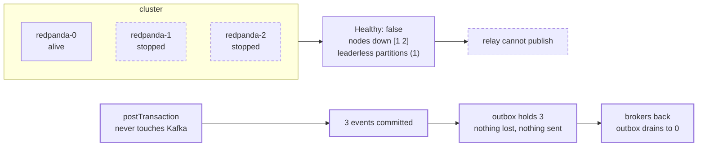
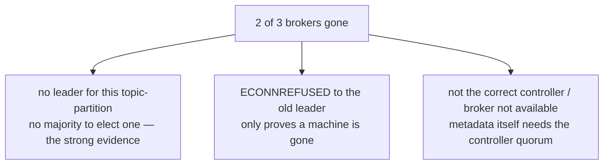

# drill:quorum — losing the majority

```bash
pnpm drill:quorum
```

Stops two of three brokers. The interesting assertion is not that Kafka broke — it is that the
ledger did not: `postTransaction` never touches Kafka, so commands keep committing, the outbox
absorbs the backlog, and recovery drains it.

Needs the three-broker cluster in `infra/docker-compose.yml` and a topic with `replicationFactor: 3`.

## What happens



One majority loss, three distinct client symptoms — all observed:



## Step by step

| # | Code | Why |
|---|------|-----|
| 1 | `publishBatch` loop | Start from a drained outbox so the counts below are about this drill. |
| 2 | `compose("stop", "redpanda-1", "redpanda-2")` | Deliberately **not** redpanda-0 — see the gotchas. |
| 3 | `waitForUnhealthy()` | Polls `rpk cluster health` until the cluster notices, and logs how long that took. |
| 4 | `Healthy: false` assertion | The surviving broker saying it itself. Without this the drill only shows that a machine is gone — a single-broker cluster would fail a produce the same way. |
| 5 | 3 × `postTransaction` | **The headline.** Kafka is unavailable and the ledger accepts every command. |
| 6 | `COUNT(*) FROM events WHERE idempotency_key = ANY($1)` | Read back from the database, not inferred from the absence of a throw. |
| 7 | `pending(pool) === DURING_OUTAGE` | The outbox absorbed all three. |
| 8 | `publishBatch` expected to fail | Captured and printed, not swallowed. |
| 9 | `compose("start", …)`, drain loop | Recovery needs no intervention beyond the brokers returning. |
| 10 | `pending(pool) === 0` | The backlog drained. |

## Gotchas

- **Don't kill the bootstrap broker.** Kill the one your client seeds from and you get a connection
  error, not an observation about quorum. `KAFKA_BROKERS` lists all three for the same reason.
- **Failure detection is not instantaneous.** The cluster reported itself `Healthy: true`,
  `Nodes down: []` for roughly 100ms after losing two of three nodes — a check run immediately after
  `docker compose stop` reads the state from *before* the fault. Meanwhile the producer failed at
  once: a client discovers a dead leader by trying to talk to it, not by being told.
- **`rpk` exits `10` to *mean* unhealthy**, the way `grep` exits 1 for "no match". A wrapper that
  rejects on any non-zero status throws away the verdict it was sent to fetch — and reports it as a
  crashed command, which sends you looking at the wrong thing.
- **Restore the cluster in `finally`.** A half-dead stack makes the next unrelated command fail
  mysteriously.
- **Don't `assert(true, …)`.** The headline claim was written that way first, which made the one
  statement the drill exists for the only one that could not fail.
- **Don't swallow the publish failure.** A bare `catch` makes "the publish failed" pass just as
  happily for a Postgres error or a typo as for a broker outage.
- Use a producer with a short retry budget. The real relay should retry patiently; a drill that
  waits out kafkajs's default backoff proves the same thing in two minutes instead of ten seconds.

## What it actually demonstrates

`min.insync.replicas` is **not** the mechanism here. Redpanda does not surface it as a topic config
or a cluster property, and the create-topic call accepted it and ignored it. The guarantee comes from
Raft: each partition is its own Raft group, and an RF=3 partition needs two of its three replicas to
elect a leader or commit a write.

The sharpest evidence is the produce error, not the health dump:

```
There is no leader for this topic-partition as we are in the middle of a leadership election
```

That is the surviving broker saying it *has* the partition and cannot elect a leader for it. A
`ECONNREFUSED` — which earlier runs produced — only proves the machine holding the leader is gone,
and a single-broker cluster fails that way too. This message has no explanation other than a
missing majority.

**Trust the produce path over the health dump.** `rpk cluster health` is answered from the local
node's own report, which is computed periodically and lags: a run has shown
`Leaderless partitions (0)` while the producer was simultaneously being told there was no leader,
and has shown `Nodes down: [1 2]` for minutes after both nodes had rejoined. Ask the controller if
you want the cluster's view, and treat a non-controller's answer as one node's opinion.

## A passing run

```
[DRILL] ok — outbox drained before the outage
[DRILL] stopping redpanda-1, redpanda-2 — keeping redpanda-0 alive
[DRILL] cluster noticed after 96ms
Healthy:                          false
Unhealthy reasons:                [nodes_down]
Nodes down:                       [1 2]
[DRILL] ok — the surviving broker reports the cluster unhealthy — quorum lost
[DRILL] ok — 3 transactions committed with the cluster below quorum
[DRILL] ok — the outbox absorbed all 3 — nothing was lost, nothing published
[DRILL] publish failed with: There is no leader for this topic-partition as we are in the middle of a leadership election
[DRILL] ok — the relay could not publish — the partition leader was gone …
[DRILL] restarting redpanda-1, redpanda-2
[DRILL] ok — the relay drained the backlog once the cluster recovered

[DRILL] passed — a broker outage degraded to lag, not to lost or refused writes
```

## Related

- [ADR 0008](../../../../docs/decisions/0008-replication-and-quorum.md) — three brokers, RF=3, and
  giving up writes below a majority
- [ADR 0003](../../../../docs/decisions/0003-outbox-and-event-partitioning.md) — the outbox that
  turns this outage into lag
