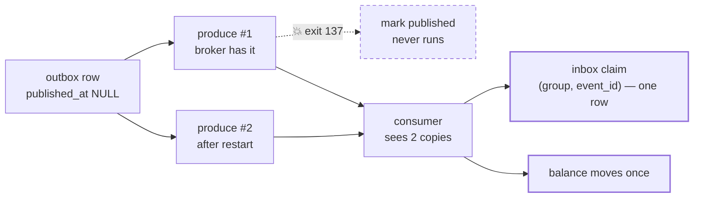

# drill:relay — the relay dies between produce and mark

```bash
pnpm drill:relay
```

The relay publishes a message and is killed before it can mark the outbox row. On restart it
publishes the same event again — and the ledger must move money exactly once anyway.

[ADR 0003](../../../../docs/decisions/0003-outbox-and-event-partitioning.md) chose produce-then-mark,
which makes delivery at-least-once. This is the drill that shows the duplicate actually happening,
and the inbox absorbing it.

**Run with the balances consumer stopped** — `balances` has exactly one writer
([ADR 0004](../../../../docs/decisions/0004-write-side-balances.md)), and for the length of this
drill that writer is the drill.

## What happens



Two offsets, one event, one movement of money:

```
[CONSUMER] applied 41edded7… (ledger.events/1@0)
[CONSUMER] skipped duplicate 41edded7… (ledger.events/1@1)
```

Both copies land on the same partition, because the partition key is `transaction:<event_id>` — a
republished message stays in order relative to its original rather than racing it from elsewhere.

## Step by step

| # | Code | Why |
|---|------|-----|
| 1 | `drainOutbox` | Anything already pending would be published ahead of ours, so the child would kill itself on somebody else's message. |
| 2 | `createConsumer` (fresh group) | Started **before** the event is produced, so it sees this drill's messages. |
| 3 | `if (msg.key !== key) return` | Skips messages belonging to other runs — see the gotcha below, it is not the usual advice. |
| 4 | `postTransaction` | One event, one outbox row. |
| 5 | `spawn(tsx, [self, "--child"])` | The child runs `publishBatch(pool, killAfterSend(producer), 1)`. |
| 6 | `killAfterSend` | Awaits the real `send`, then `process.exit(137)` — after the broker has the message, before the `UPDATE`. No change to the relay was needed. |
| 7 | exit 137, row still unpublished | Produced, not marked: the exact gap the ADR describes. |
| 8 | `drainOutbox` again | The restart. The relay has no memory of the first attempt and publishes a second copy. |
| 9 | 2 copies seen, balance `=== AMOUNT`, 1 inbox row | At-least-once delivery, exactly-once effect. |

## Gotchas

- **Teardown belongs in `finally`, not `catch`.** With cleanup in `catch`, the success path skips it
  entirely: every assertion passes, the drill prints its result, and the process never exits.
- **Filter to your own message key.** A fresh consumer group has no inbox rows, so it re-applies the
  entire retained log — silently doubling the balances of every previous run's accounts while this
  run's assertions stay green, because they are scoped to accounts the corruption never touches.
  Skipping is normally the cardinal sin; here the group exists for one run and its cursor is
  discarded afterwards.
- **`clearTimeout` the race timer.** A pending 30-second timeout holds the event loop open long
  after the work is done, and looks identical to a hang.
- **Assert exit code 137 exactly.** A child that dies on a module it cannot resolve also exits
  non-zero.
- **Drain the outbox first**, or the child kills itself publishing an unrelated row.

## A passing run

```
[DRILL] spawning a relay that will die mid-publish
💥 published 41edded7…, killing before the mark
[DRILL] ok — relay died mid-publish (exit 137)
[DRILL] ok — the outbox row is still unpublished — produced, not marked
[DRILL] restarting the relay
[DRILL] ok — the outbox row is marked published after the restart
[DRILL] ok — both copies were delivered (saw 2)
[DRILL] ok — money moved exactly once (balance 100)
[DRILL] ok — the inbox claimed the event once

[DRILL] passed — at-least-once delivery, exactly-once effect
```

## Related

- [ADR 0003](../../../../docs/decisions/0003-outbox-and-event-partitioning.md) — produce-then-mark,
  chosen deliberately
- [ADR 0005](../../../../docs/decisions/0005-consumer-inbox.md) — the inbox that makes it safe
